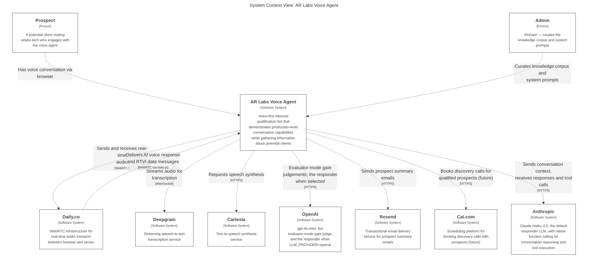
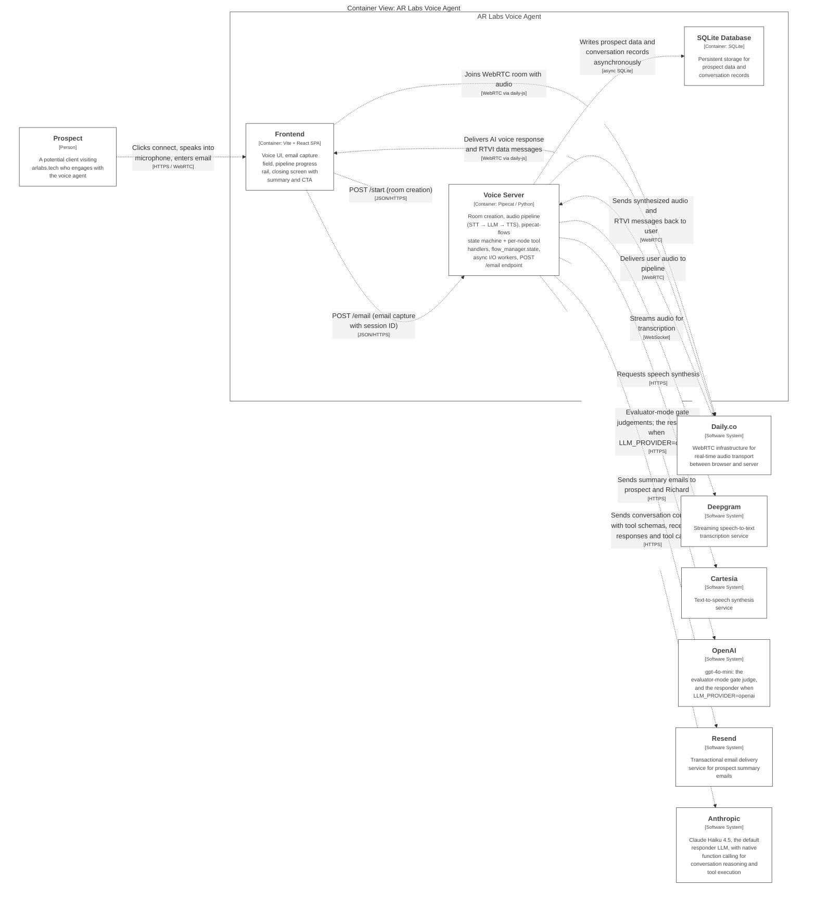
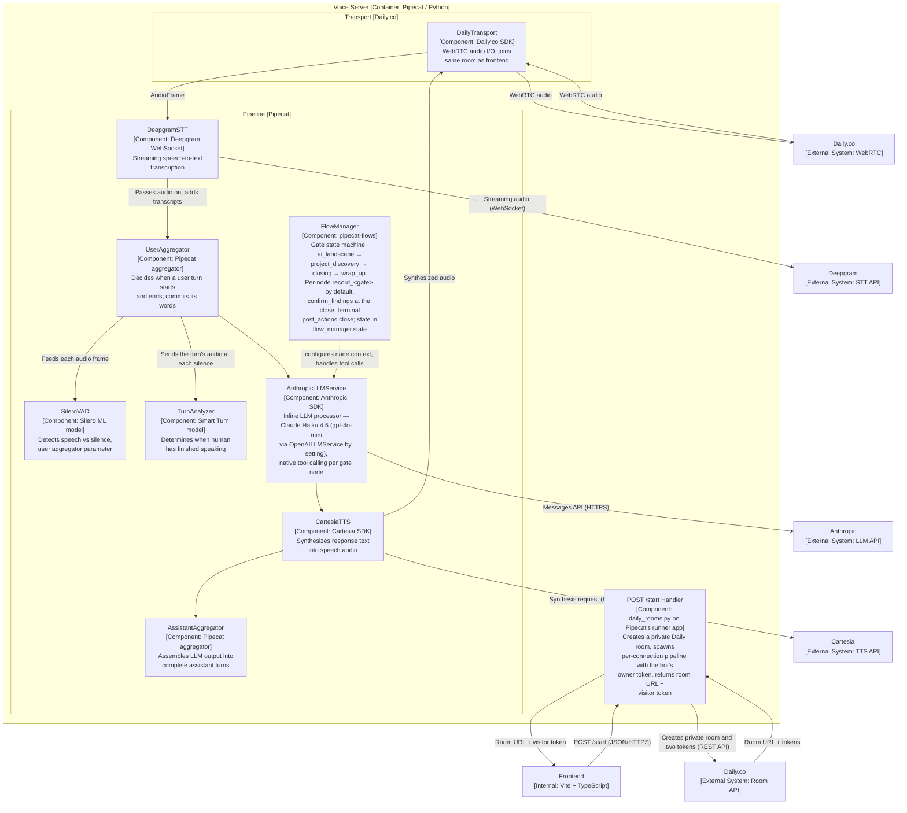

# AR Labs Voice Agent — Design Document

**Last Updated:** 2026-06-16
**Framework:** Google Design Doc format (see `DESIGN-FRAMEWORK.md` in VOX soft-eng reference)
**Original Reference:** `infra/matrix/Projects/salesbot/DESIGN.md` (26K-line codebase design, end-state inspiration)

This is a living architecture document — it describes what the system **is**, not what each version added. Updated after each version ships. Version progression and capability roadmap live in [STRATEGY.md](./STRATEGY.md). Implementation history lives in [BUILD.md](./BUILD.md).

---

## 1. Context and Scope

A voice-first inbound qualification bot that demonstrates production-level conversation capabilities, while gathering information about potential clients.

The bot uses a simplified SPIN selling framework, moving the prospect from initial conversation, to information gathering, to identification of a specific problem, to booking an appointment with a representative.

The conversational journey is mapped visually, and the bot's internal workings are exposed to demonstrate underlying mechanisms while simultaneously gathering client info verbally.

It is hosted on arlabs.tech — the VOX Systems Inc. platform for Richard's freelancing AI and Software Engineering work.

**Build approach:** The system is built incrementally from scratch. Architectural insights from the original salesbot (26K lines, 3-app architecture) inform design decisions, but every line is written fresh.

**Directory ownership:**

| Directory                                     | Role                                                                                                                     |
| --------------------------------------------- | ------------------------------------------------------------------------------------------------------------------------ |
| repo root (`~/CODE/projects/salesbot/`)                | Project management, design, and Python backend (this doc, BUILD.md, STRATEGY.md, ADRs, `backend/voice/`)                 |
| `frontend/`                                   | Frontend source code (Vite + React + Tailwind — standalone SPA per [ADR-011](docs/adr/ADR-011.md)). React-minimal: `AppMinimal.tsx` + `@pipecat-ai/client-react`, with framework-free rail logic in `lib/pipeline.ts`. |
| `infra/matrix/Projects/salesbot/`             | Reference material (original codebase for architectural inspiration)                                                     |



_C4 Level 1: System Context — the voice agent in its environment. Diagrams pending regeneration via c4-diagram agent for AR Labs theming._

### Key Concepts

These terms appear throughout the design. Grouped by the two layers of the voice system.

#### Transport Layer

- **WebRTC** — Real-time protocol carrying audio between browser and server. Daily.co provides this.
- **Room** — A Daily.co WebRTC session that both the frontend and Voice Server join. Created on-demand, short-lived.
- **VAD (Voice Activity Detection)** — ML model detecting whether someone is currently speaking. Runs on the raw audio inside the pipeline's user aggregator, which uses it to decide when a visitor's turn starts and ends.
- **Turn-taking** — Logic determining when a speaker has finished, allowing the other party to respond. In Pipecat it is the user aggregator's turn rules: what starts a turn (the voice detector, or a final transcript), and what ends it (the Smart Turn model, held for up to 3 s when its "finished" meets a transcript that stops mid-sentence, or a time-out).
- **Barge-in** — When the user interrupts the AI mid-speech. The system must stop generating and listen.
- **Transport** — The layer that moves audio and handles timing. Analogy: ears and mouth.

#### Pipeline Layer

- **Pipeline** — Ordered chain of processors transforming audio into meaning and back. Analogy: brain.
- **Processor** — Single step in the pipeline with one responsibility (transcription, LLM call, synthesis).
- **STT (Speech-to-Text)** — Converts spoken audio into text. Deepgram provides this via streaming.
- **TTS (Text-to-Speech)** — Converts text into spoken audio. Synthesizes the AI's voice.
- **RTVI (Real-Time Voice Inference)** — Coordination processor controlling when the AI should speak, stop, or be interrupted.
- **Frames** — Typed data chunks (audio, text, control signals) flowing between processors.

---

## 2. Goals and Non-Goals

### 2.1 Goals

#### 2.1.1 Do its job

As an inbound sales representative, the bot should engage prospects, obtain pertinent information about their company, identify potential problems, and surface areas where VOX Systems Inc. could help them achieve their goals.

**Tests:**

- Fluent back-and-forth conversation with prospect produces data
- Pre-set data demands provide success metrics
- Data is stored and sent to VOX Systems Inc.
- SPIN Selling framework is defined and implemented in conversation loop
- Bot works through conversational stages in sequence until completion
- Bot can describe pertinent aspects of VOX Systems Inc.'s capabilities
- Prospect hears something they said reflected back in structured form at least once
- Post-call summary email (via Resend, to prospect and Richard) contains: stated pain points, desired outcomes, and qualification assessment

#### 2.1.2 Provide real insight to the customer

Generate value for the customer. Ask penetrating questions that enable the customer to think in a new way about their problem.

**Tests:**

- Bot reaches Implication questions (not just Situation/Problem) in >50% of sessions that reach DISCOVERY

#### 2.1.3 Be fun to use / Feel like a game

Talking to the bot should feel like a game — clear goal, clear rules, visible progress, fulfilling conclusion. The more interesting the verbal narrative and visual journey, the longer the prospect continues. Longer conversations mean more value for the customer and more data for us.

If the initial pipeline completes but the customer still wants to talk, allow an extended "bonus round" rather than ending the session.

**Tests:**

- Visual component of progress through the journey
- Clear indications of how the system judges progress at each stage
- Clear end-point with indications of benefits the prospect receives on completion

#### 2.1.4 Be a replicable backbone

This system forms the front-end framework for various AI-based applications produced by VOX Systems Inc. — the VOX system itself, online interfaces, the CEO agent, etc. As a company specializing in voice-first AI applications, this framework should be adaptable to different use cases and evolved over time.

**Tests:**

- Voice pipeline, conversation engine, and frontend can be deployed independently for other use cases
- Core abstractions (conversation phases, qualification scoring, context ingestion) are not hardcoded to sales

### 2.2 Non-Goals

- Closing deals inside the bot (goal is qualification, not sales)
- Supporting outbound cold calls (inbound only for MVP)
- Multi-language support (English only for MVP)
- CRM integration (standalone system, no Salesforce/HubSpot)

---

## 3. System Design

### Architecture

Two application containers (Frontend + Voice Server) plus SQLite for persistent storage. The LLM runs **inline** as a Pipecat pipeline processor with native function calling for tool execution: `AnthropicLLMService` on Claude Haiku 4.5 by default, or `OpenAILLMService` on gpt-4o-mini with `LLM_PROVIDER=openai` (see [ADR-022](docs/adr/ADR-022.md); `bot.responder_choice` reads the choice from the environment). There is no separate LLM module, no HTTP bridge, no Agent SDK (see [ADR-013](docs/adr/ADR-013.md)). The conversation itself is a **pipecat-flows `FlowManager` state machine** layered on top of that inline tool calling — discrete gate nodes the bot moves through by calling per-node functions (see [ADR-020](docs/adr/ADR-020.md)). The frontend is a **React-minimal** SPA ([ADR-011](docs/adr/ADR-011.md)).



_C4 Level 2: Container Diagram — two application containers plus SQLite storage. LLM stays inline with native tool calling. Diagrams pending regeneration via c4-diagram agent for AR Labs theming._

| Container | Responsibility | Scope |
| --- | --- | --- |
| **Frontend** | UI rendering, user interaction | Connect / End Session and microphone controls, a visitor box for typed replies during a call, pipeline progress rail driven by RTVI gate messages, closing screen with summary and CTA; email capture is planned, not built |
| **Voice Server** | Room creation, hearing, thinking, speaking, tool execution, email receipt | The salesbot's own `POST /start` on Pipecat's runner app (`daily_rooms.py`: a private, expiring room per call, an owner token for the bot and a participant token for the visitor), DailyTransport (WebRTC audio), pipeline (STT → user aggregator with the voice detector and turn rules → inline LLM service, `AnthropicLLMService` on Claude Haiku 4.5 by default, with native tool calling → TTS), pipecat-flows `FlowManager` driving the gate state machine, per-node `record_<gate>` handlers by default, closing-node `confirm_findings` and a terminal `wrap_up` node that closes the call, optional evaluator comparison mode, the follow-up door `POST /follow-up` (vox-9ji.2.14.4; `POST /email` is planned), per-session state in `flow_manager.state`, async background workers for SQLite/Resend/RTVI |
| **SQLite Database** | Persistent storage | Four tables: `prospects` (identity; declared, never written), `conversations` (session data, transcript, findings, email status), `follow_ups` (one row per visitor who left an email on the closing screen) and `messages` (each message a visitor sent Richard from the message box). Gate completions are the write trigger — no gate passed, no record created. Async writes only — never in the voice hot path. See [ADR-015](docs/adr/ADR-015.md). |

### Frontend (salesbot.arlabs.tech)

A Vite + React SPA hosted at `salesbot.arlabs.tech` (a subdomain on the VPS — see [ADR-008](docs/adr/ADR-008.md), [ADR-011](docs/adr/ADR-011.md)). Built as a Vite static export and served by Caddy. Same origin as the voice server's `/start` route — no CORS configuration needed. Contains:

- A status light reading Offline, Connecting or Live
- The Connect / End Session button, and while connected the microphone toggle
- The voice switch between the status light and Connect, at every width (`components/VoiceSwitch.tsx`, vox-9ji.2.25): "Bot voice", Male or Female, Male on load and kept for the page visit only, with a fixed helper line. The call starts in the chosen voice (contract 1); flipping the switch during the page's own call changes the voice from the bot's next reply (contract 7)
- The visitor box at the foot of the call-controls card, under Connect and the microphone toggle, at every width, during the page's own live session: a single-line field where the visitor can type a reply instead of speaking it (`components/TypedReply.tsx`, vox-9ji.2.15). Its lines travel as `typed-reply` client messages (interface contract 5) and the bot treats them as speech
- Pipeline progress rail (sales conversation visualization driven by gate completions), on the left at wide screens and as a row above the controls on narrow ones
- The status window, saying in plain words what the bot is finding out now and which answers it has (`components/GateStatus.tsx`, fed by `gate_status`): in the right-hand column on wide screens, as wide as the rail's column, the two sharing what the narrow 18rem call card leaves (`side-column` in `globals.css`) and under the call controls on narrow ones, its state held once by the page (vox-9ji.2.14.3)
- The transcript strip along the bottom, at every width (`components/ConversationFeed.tsx`): both sides of the call, the bot's words as they are spoken and the visitor's spoken or typed lines, labelled `You`, from final `user-transcription` messages (vox-9ji.2.14.3). It is the development strip shipped as it is; the transcript designed for the public page is vox-9ji.2.19
- The closing screen, a full-page overlay shown when the bot ends the call (vox-9ji.2.14.4): the backend's summary on the left with "Book a call with Richard" under it, which opens the message box (vox-9ji.2.14.15, contract 6); on the right, the next steps: a preview of the engineering chat, the feature map with a tick box per planned feature, an email field whose address and ticks go to the follow-up door (contract 6), and links to arlabs.tech and Richard's LinkedIn page. Two columns from `lg`, stacked and scrolling below it
- The AR Labs skins, taken from the AR Labs Projects page and the proposed front page: light (paper, ink and green, with radiant, neon and purple as fills) and a dark skin, Phosphor, with the values arlabs.tech's Projects page takes in its own Phosphor skin (near-black green ground and card, pale green ink, neon accent text, the same status fills; vox-9ji.2.30), in Archivo and JetBrains Mono. The page follows the visitor's system setting until a click on the sun-or-moon button at the end of the title bar, which switches the skin and is remembered in the browser (`components/ThemeSwitch.tsx`, `lib/themeChoice.ts`). A script in `index.html`'s head applies the same rule before the first paint. The colours are the tokens in `styles/globals.css`, whose older names (`accent-mint` and so on) each now stand for a role, mapped in a comment at the top of that file (vox-9ji.2.20). **The page is composed symmetrically about its centre:** the two side cards (stage rail, status window) are one card in width, height, frame and tone, and the single emphasised element, the solid green panel, is the call card in the centre. **Motion:** nothing is added to the call screen, where animation once stuttered the call's audio. What moves now: hover colour transitions (150ms); the status lamp's opacity pulse (2s, live and connecting; static under reduced motion); the active stage's radar rings (4s loop); the rail's fill line when a stage completes (0.6s); the phone progress bar (0.5s); the transcript cursor while the bot speaks (static under reduced motion); the closing screen's entrance (0.4s) and the scan line on its rules (3s loop). Nothing glows. The spec of vox-9ji.2.20 lists each with its curve.
- A development-only surface, compiled out of every production build: the replay panel on the left (also hidden on the development server when `VITE_REPLAY_PANEL` is set to anything but `on`)

The closing screen's email field (contract 6) is the only email capture built. Email capture during the call (contract 3) is planned, not built.

**Frontend implementation (resolved — React-minimal):**

The frontend is a deliberately thin React build. The entry is `src/main.tsx` → `AppMinimal.tsx`, using `@pipecat-ai/client-react`. The decision-bearing logic lives **outside** React in framework-free modules so the component layer stays trivial:

| Module | Role |
|---|---|
| `AppMinimal.tsx` | Thin React root — renders the rail + Connect / End-Session button; the closing screen mounts here, and the visitor box while the page's own session is connected |
| `lib/typedReply.ts` | Pure rules for the visitor box — normaliser, limits and the Send assessment, pinned with the backend's to `lib/typedReply.contract.json` |
| `lib/themeChoice.ts` | Which skin the page wears: the system setting until the visitor clicks the switch, then the stored skin, with storage that may be denied (vox-9ji.2.20) |
| `lib/storageFallback.ts` | The first import in `main.tsx`: when the browser blocks site data, so that reading `localStorage` or `sessionStorage` throws, puts an in-memory store for the visit in its place, because Daily's code reads storage on Connect without catching (vox-9ji.2.14.8) |
| `lib/voiceChoice.ts` | The voice switch's two words, the `set-voice` message type and the switch's copy (vox-9ji.2.25) |
| `lib/pipeline.ts` | Pure, framework-free rail logic — `applyServerMessage` folds `gate_complete` / `gate_moved_on` / `end_session` / `session_ref` RTVI messages into `PipelineState` (unit-tested in `pipeline.test.ts`) |
| `lib/nextSteps.ts` | Pure rules and copy for the closing screen's next steps (vox-9ji.2.14.4): the feature map from `lib/nextSteps.contract.json` (the list Richard edits, pinned by a backend test), every visible string, the page's email check, the follow-up request body and response reading |
| `lib/messageBox.ts`, `hooks/useMessageBox.ts`, `components/MessageDialog.tsx` | The message box (vox-9ji.2.14.15), opened by "Book a call with Richard" and by the busy line: its rules and copy, its state, and the native modal dialog that draws it. Nothing on the page opens the visitor's email program |
| `hooks/useFollowUp.ts` | The closing screen's email field: its state, and `postFollowUp`, the page's one request to `POST /follow-up` (ten-second timeout), which the message box also uses; double-submit protection |
| `hooks/usePipelineStage.ts` | Thin React wrapper exposing `PipelineState` to components |
| `lib/theme.ts` | Pipeline stage map (gate id → stage). Its `colors` and `fonts` exports are unused; the page's colours are the tokens in `styles/globals.css` |
| `lib/gates.contract.json` | Cross-boundary contract — frontend stage set vs backend `GATES`, guarded by a contract test so they cannot drift |

**History:** An earlier vanilla-TS experiment (`src/main.ts`, direct DOM mutation) was tried because React's reconciliation cycle was competing with WebRTC initialisation for the main thread during connection, freezing the app at session start. That contention is now avoided by the React-minimal shape — the heavy per-frame logic is pure functions in `lib/pipeline.ts`, and React only renders. The vanilla-TS build has been dropped; React is the decided frontend ([ADR-011](docs/adr/ADR-011.md)).

DESIGN.md intentionally does not duplicate the component tree. The frontend's interface with the rest of the system is defined by the interface contracts below (room creation handshake, shared Daily room, RTVI events).

### Voice Server

Single Pipecat process on VPS (`uv run bot.py -t daily`) handling room creation and the real-time audio pipeline. Pipecat separates the voice system into two layers: a **transport** (Daily.co — moves WebRTC audio in and out) and a **pipeline** (processors that transform speech to meaning and back). Timing lives in the pipeline too: the user aggregator runs the voice detector (Silero) on the incoming audio and applies the turn rules that decide when the visitor has started and finished speaking (Pipecat 0.0.108 configures both on the user aggregator, not on the transport; `bot.live_user_params()`, and `backend/voice/CLAUDE.md`, "How a live user turn starts and ends").

The LLM runs **inline** as a pipeline processor that calls the model's API directly: `AnthropicLLMService` (Claude Haiku 4.5) by default, `OpenAILLMService` (gpt-4o-mini) when `LLM_PROVIDER=openai` ([ADR-022](docs/adr/ADR-022.md)). Pipecat manages the detect-execute-re-infer loop natively (see [ADR-013](docs/adr/ADR-013.md)).

On top of that inline tool calling, the conversation is a **pipecat-flows `FlowManager` state machine** (see [ADR-020](docs/adr/ADR-020.md)). The flow is `ai_landscape → project_discovery → closing → wrap_up`. In the default `GATE_MODE=responder` regime, each gate node exposes one repeatable `record_<gate>` function. Its all-optional schema lets the responder record one or several findings as they emerge. The handler sanitizes and merges those findings into `flow_manager.state[gate_id]`, runs `gate_is_complete`, and returns the next node only when the accumulated state is complete. The closing node exposes `confirm_findings` (and `end_conversation` as a latent fallback); the terminal `wrap_up` node exposes no tools and ends the call from a `post_actions` entry. The `GATES` dict in `tools.py` remains the single source of truth: it generates the conversational guidance and both mode-specific schemas. Per-node prompts (`task_messages`) replace a monolithic system prompt; `role_message` is set only on the first node. pipecat-flows delivers a node's prompt and tools as interruptible frames, so each gate and the closing node also remembers them at entry, and the stage guard (`stage_guard.py`, vox-2cl.30) restores them just before a model run if a visitor's interruption dropped them: the model never runs a gate or the closing stage without its instruction and tools. `GATE_MODE=evaluator` retains the earlier completion-only tool and off-path evaluator for controlled comparison. See [ADR-021](docs/adr/ADR-021.md).

Room creation is handled by the salesbot's own `POST /start` route (`backend/voice/daily_rooms.py`), mounted on Pipecat's runner app in place of the runner's built-in route. When the frontend calls it, it creates a private Daily.co room, starts a per-connection pipeline with an owner token for the bot, and returns the room and a separate participant token for the visitor. A log cleaner (`backend/voice/log_hygiene.py`) keeps room URLs and line breaks out of every log line.

#### C3: Voice Server Components



_C4 Level 3: Component diagram for Voice Server. See [`docs/pipecat-architecture.md`](docs/pipecat-architecture.md) for deeper framework detail (frames, PipelineTask, observers). Diagrams pending regeneration via c4-diagram agent for AR Labs theming._

**Component responsibilities:**

| Component              | Technology              | Responsibility                                                                                                 |
| ---------------------- | ----------------------- | -------------------------------------------------------------------------------------------------------------- |
| **POST /start**        | `daily_rooms.py` on Pipecat's runner app | HTTP endpoint that refuses a call as busy past its daily and at-once limits, and otherwise creates a private, two-hour Daily.co room per call (REST API), an owner token for the bot and a participant token for the visitor, and spawning the per-connection pipeline. Replaces the runner's own `/start` and `GET /`, which made public rooms. |
| **DailyTransport**     | Daily.co SDK            | WebRTC audio I/O, joins same room as frontend. Receives mic audio from Daily.co, sends synthesized audio back. |
| **SileroVAD**          | Silero ML model         | Detects speech vs silence. A parameter of the user aggregator (`vad_analyzer`), not a pipeline processor and not a transport parameter; its thresholds are set in `bot.live_user_params()`. |
| **TurnAnalyzer**       | Pipecat Smart Turn model | Determines when the human has finished speaking. The user aggregator's stop rule: when the voice detector reports silence it judges whether the turn is over. Wrapped by the sentence hold (`backend/voice/sentence_hold.py`, vox-2cl.29): a "finished" verdict on a transcript with no closing `.`, `?` or `!` holds the turn up to 3 s, cancelled if the voice returns. |
| **DeepgramSTT**        | Deepgram WebSocket      | Streaming speech-to-text transcription with low-latency endpointing configuration.                             |
| **UserAggregator**     | Pipecat aggregator      | Decides when a user turn starts and ends (voice detector, turn rules, a 5 s stop time-out) and commits the turn's transcripts to the conversation before passing it to the LLM. The reply guard (`reply_guard.py`) answers a visitor message left unanswered when a turn ends with no words. |
| **AnthropicLLMService** | Anthropic Python SDK   | Inline LLM processor — calls Claude Haiku 4.5 by default; `OpenAILLMService` on gpt-4o-mini when `LLM_PROVIDER=openai` (ADR-022). Both run tool calls one at a time. The Claude service has prompt caching on: each request asks Claude to keep its unchanged opening, read back by the next at a tenth of the input price, once past Haiku 4.5's 4,096-token minimum and until a stage change. A missing key for the chosen provider stops the session at assembly. Pipecat manages the native tool-call loop; the active node's mode-selected `record_<gate>` or `complete_<gate>` schema, the closing node's `confirm_findings`, and each prompt come from `FlowManager`. |
| **FlowManager**        | pipecat-flows           | The conversation state machine. Holds the gate nodes (`ai_landscape → project_discovery → closing`), supplies each node's prompt + `FlowsFunctionSchema` (from `GATES`), runs the validate-then-transition handlers, and owns per-session state in `flow_manager.state`. Coexists with the auto-wired RTVI observer ([ADR-020](docs/adr/ADR-020.md)). |
| **CartesiaTTS**        | Cartesia SDK            | Synthesizes LLM response text into speech audio for playback through the transport. The live stage is `voice_link.GuardedCartesiaTTSService`: Pipecat's Cartesia service with a watch on every reply's first audio, which replaces a stalled connection, re-sends the reply whole, and plays a recorded line in the reply's voice when Cartesia cannot be reached (vox-2cl.27). Each reply speaks in one of two voices (`bot.VOICES`, vox-9ji.2.25): the call starts in the visitor's choice and a change applies from the next reply, never within one. |
| **AssistantAggregator**| Pipecat aggregator      | Assembles streamed LLM output into complete assistant turns for transcript/RTVI events.                        |

ADRs: [ADR-003](docs/adr/ADR-003.md) (Pipecat), [ADR-004](docs/adr/ADR-004.md) (Daily.co), [ADR-005](docs/adr/ADR-005.md) (Deepgram), [ADR-012](docs/adr/ADR-012.md) (Cartesia TTS), [ADR-013](docs/adr/ADR-013.md) (Pipecat native tool calling), [ADR-022](docs/adr/ADR-022.md) (Claude Haiku 4.5 responder, superseding ADR-014), [ADR-020](docs/adr/ADR-020.md) (pipecat-flows state machine)

### Interface Contracts

Stable boundaries between containers. Internal implementations can change without affecting other containers as long as these contracts hold.

**1. Frontend → Voice Server: Room Creation**

```
POST /start
Content-Type: application/json

Request:  { "createDailyRoom": true, "body": { "voice": "male" | "female" } }
Response: { "dailyRoom": "https://xxx.daily.co/salesbot-<12 hex>", "dailyToken": "eyJ... (the visitor's)", "sessionId": "uuid" }
```

The frontend calls this once per session via `client.startBotAndConnect({ endpoint: "/start" })`. The voice server's own route (`backend/voice/daily_rooms.py`, vox-9ji.2.22.2) answers it. It creates a **private** Daily.co room, which only a meeting-token holder can join, that expires two hours after creation and ends any meeting still running then, and names no region. With no region named, Daily places the call's server (the SFU) in the region nearest the first participant to join, which is the visitor or the bot, so it sits on the path between them (vox-9ji.2.22.4). It issues two tokens for that room: an owner token the bot joins with, and a participant token, ejected at the room's expiry, that it returns as `dailyToken`. Everything else the request carries is ignored: `dailyRoomProperties`, `dailyMeetingTokenProperties`, `DAILY_ROOM_URL` in the server's environment, and every key but the nested `body`, which reaches the bot untouched. If Daily refuses, the answer is 503 `{"error": "no room available"}`. Before any of this, the route checks its call limits (vox-9ji.22): at most `CALLS_AT_ONCE` calls in progress (default 2) and `CALLS_PER_DAY` started in a UTC day (default 30), both a best guess Richard has not ruled on. Past either, it answers 503 `{"error": "busy", "info": "busy"}` without calling Daily, and the page shows a busy message with Richard's email address (`backend/voice/CLAUDE.md`, "Call limits on `/start`"). The deploy script's two post-restart checks are admitted outside those limits (vox-9ji.29): each sends `Authorization: SalesbotDeployCheck <run id>`, the id systemd gives the restarted service, which the route reads from `INVOCATION_ID` and honours, byte for byte, for ten minutes after the app is built. Any other request, with any other header or none, is counted. The route then spawns a per-connection pipeline, and the frontend joins the room directly using `daily-js`, passing the token. The page adds the visitor's voice choice as `body.voice` (vox-9ji.2.25); it reaches the bot inside `body`, so it is not a room setting. The server accepts exactly `male` or `female`; a request with no choice gets the male voice, and anything else gets the male voice and one warning. The development replay panel sends the room request plus `body: { "replay": true }`, and the deploy script's post-restart checks send the room request with no voice choice, so a deploy exercises the no-choice path; `frontend/src/lib/start-request.test.ts` and `backend/voice/tests/test_start_request.py` hold the three in step.

**2. Frontend ↔ Voice Server: Shared Daily.co Room**

No direct interface. Both the frontend (via `daily-js` in the browser) and the Voice Server (via `DailyTransport` on the server) join the same Daily.co room. Audio flows through Daily.co's WebRTC infrastructure. RTVI events (transcript, speaking state, bot output) flow over Daily data channels. The containers never communicate directly after room creation — Daily.co is the intermediary.

**3. Frontend → Voice Server: Email Capture**

```
POST /email
Content-Type: application/json

Request:  { "sessionId": "uuid", "email": "prospect@example.com" }
Response: { "status": "ok" }
```

Planned, not built: vox-9ji.2.3 (Capture email without voice) owns it, for the visitor's own summary email. The frontend would send this when the user submits their email in a persistent input field during the call; the voice server would associate the email with the active session and fire a background SQLite write. See [ADR-016](docs/adr/ADR-016.md). The closing screen's email field, built, uses contract 6 instead, and contract 3 can reuse its session reference.

**4. Voice Server → Frontend: RTVI Gate Updates**

On each accepted recording, the handler sends a cumulative `{action: "findings_update", gate, items:[{label, value}]}` message to the frontend; no page listens for it today. When `gate_is_complete` accepts the accumulated state, the same handler fires `{action: "gate_complete", gate, findings}` and returns the next node; `gate_complete` means every answer of the gate was gathered, and the replay tools count it as completion. When a gate reaches its safety limit unfinished and the conversation is moved on (data flow 5), the recorder sends `{action: "gate_moved_on", gate}`, carrying the gate id and nothing else (vox-2cl.23). The page's progress rail (`lib/pipeline.ts`) is the consumer of both: it shows a gate's stage finished on either message. Evaluator mode produces the same contracts from its observer-driven path. The page's status window folds `gate_status` (see the Real-Time Control Plane table). The closing sequence sends `{action: "end_session", reason, summary}`: `reason` is `complete` for a confirmed close and `bail` for an early end, and `summary` is the text `render_summary` builds from the accepted findings. It finishes the rail's last stage and triggers the closing screen, which shows the summary.

**6. Frontend → Voice Server: The follow-up door (vox-9ji.2.14.4)**

```
POST /follow-up
Content-Type: application/json
Body (at most 8192 bytes), exactly one of:
  { "sessionRef": "<32 lowercase hex>", "email": "<at most 254 characters>", "interests": ["<feature id>", ...] }
  { "sessionRef": "<32 lowercase hex>", "email": "<address>", "message": "<1 to 1000 characters>" }
  { "email": "<address>", "message": "<1 to 1000 characters>" }

200  { "status": "received" }        recorded now, or already recorded for this session
400  { "error": "invalid_email" }     the address fails the server's rules
400  { "error": "unknown_interest" }  an id not in the feature map, or a repeated id
400  { "error": "invalid_message" }   empty, over 1000 characters, a control character other than line feed and tab, or a lone surrogate
400  { "error": "bad_request" }       not JSON, not an object, a missing or extra key, a wrong type
404  { "error": "unknown_session" }   malformed reference, or no session the bot closed behind it
413  { "error": "too_large" }         body over 8192 bytes
429  { "error": "rate_limited" }      over five requests per client address in ten minutes; or, without a session,
                                       over three messages per client an hour or twenty accepted server-wide a day
429  { "error": "message_limit" }     a session that already sent three messages
503  { "error": "unavailable" }       the database could not be opened or written
```

Sent once by the closing screen's email field (`hooks/useFollowUp.ts`). `sessionRef` is the session's database id, which the server sent the page as a `session_ref` message at client-ready. The door (`backend/voice/follow_up.py`) checks in that order, records the request once per session in `follow_ups`, answers, and then emails Richard (always `richard@arlabs.tech`, a constant) through `backend/voice/mailer.py`, with the visitor as reply-to, the ticked feature titles and the summary rebuilt from the session's stored findings, never text from the request. Without `RESEND_API_KEY` the request is recorded with outcome `off` and nothing is sent. It is mounted on the Pipecat runner's own app, beside `POST /start`, by wrapping the runner's app factory; Caddy must forward `/follow-up` to the bot (Deployment Topology).

The two message shapes come from the message box (vox-9ji.2.14.15): with a session from the closing screen's "Book a call with Richard", without one from the busy line. Each is recorded as a row in `messages` and emailed to Richard with the visitor as reply-to and the message; from a session the email adds the summary rebuilt from the stored findings, as for a follow-up. Limits are in `backend/voice/CLAUDE.md`, "The follow-up door".

**5. Frontend → Voice Server: Typed replies (RTVI client message)**

```
sendClientMessage("typed-reply", { "text": "<what the visitor typed>" })
```

Sent over the Daily data channel (ADR-009) by the visitor box, from one send site (`hooks/useTypedReply.ts`). Fire-and-forget: there is no reply, and the bot's spoken answer is the acknowledgement. Accepted by live sessions only (`backend/voice/typed_reply.py`). The server screens each line — at most 2,000 characters raw and 500 after normalising, never empty, at least one second apart, at most 60 per call — and queues an accepted line at the pipeline head as a final transcription, so the user aggregator commits it exactly as it commits speech. A refusal is logged with its reason and length, never the text. The limits are one definition shared by both sides, `frontend/src/lib/typedReply.contract.json`. The development replay panel's `replay-inject` message is a separate type that only replay sessions accept, and a live session never acts on it. The voice server admits only `client-ready` and custom client messages from the browser and refuses RTVI's other built-in types (`send-text`, `append-to-context`, `llm-function-call-result`, `update-config` and the rest), so this message is the only way a browser writes a live conversation (`backend/voice/rtvi_guard.py`). Replay sessions need the backend's development setting, `REPLAY_SESSIONS=on`; without it a `/start` request carrying the replay flag gets an ordinary live session.

**7. Frontend ↔ Voice Server: Voice changes (RTVI client message, vox-9ji.2.25)**

```
sendClientMessage("set-voice", { "voice": "male" | "female" })
```

Sent by the voice switch during the page's own call, from one send site (`AppMinimal.tsx`), once the transport is ready. Fire-and-forget: the server sends nothing back. Accepted by live sessions only (`bot.attach_voice_changes`). The server accepts exactly one of the two words and counts every `set-voice` message toward a cap of 50 a call; a refusal is logged with the value's type and length, never the value. The speech stage applies an accepted change from the bot's next reply, so a reply is never spoken in two voices, and the last change before that reply wins.

### Data Flows

**1. Gate recording and completion (responder-driven by default):** the responder calls `record_<gate>` with any findings that have emerged → `make_record_handler` sanitizes them, applies the visitor-reply rule (nothing is recorded for a stage until the visitor has replied in it: unless a visitor message follows the bot's first turn after the gate's heading, the call stores nothing and returns a neutral `recorded` result with `not_recorded`, `reason` and a `note` telling the responder to ask; it fails closed on an unreadable conversation), and `record_findings` merges them into `flow_manager.state[gate_id]` + streams a cumulative `findings_update` RTVI message → `gate_is_complete` checks the accumulated state. If fields remain missing, the handler returns `({"status": "recorded", "gate": <gate_id>, "still_needed": [<field ids>]}, None)` and the node stays active: `still_needed` names the fields not yet captured, in registry order, from `fields_still_needed`, the function `gate_is_complete` is defined on, so the responder is told what is left and the list cannot disagree with completion (vox-2cl.22; a call that stores nothing carries it too, and it is left out once the close has been claimed or a forced move has left the gate). When every required field is present, it persists in the background, fires `gate_complete`, and returns `(result, next_node)` so `FlowManager` activates the next node; for a gate a forced move has already left (data flow 5) it persists without `gate_complete` and returns no next node. `GATE_MODE=evaluator` restores the prior off-path evaluator and `set_node_from_config` transition for comparison.

**2. Email capture (planned, vox-9ji.2.3):** User types email in frontend field → frontend `POST /email` with session ID → backend associates email with the session → background: SQLite write.

**2a. Closing-screen follow-up (vox-9ji.2.14.4):** at client-ready the server sends `session_ref` → the page keeps it through the close → the visitor ticks features and submits an email → `POST /follow-up` → the door validates, finds the ended session, inserts one `follow_ups` row and answers `200` → background: `mailer.send` to Richard, then the outcome (`sent`, `off`, `failed`) stored on the row. A message from the message box (vox-9ji.2.14.15) takes the same path into a `messages` row, with or without a session.

**3. Conversation close:** on the closing node the bot mirrors the findings back and the visitor confirms. Responder mode hears that confirmation from the model's `confirm_findings` call; evaluator mode hears it from the close judge's `done=true` verdict, read off the settled exchange after each turn. Either way the flow advances to the terminal `wrap_up` node, whose `post_actions` entry calls the idempotent `run_close_once` path → background: `end_session` RTVI message, carrying the rendered summary, to frontend → frontend shows the closing screen with it → background email/final SQLite sync → `EndFrame` ends the audio, after the spoken goodbye has drained. The registered `end_conversation` handler remains a latent fallback on the same latch.

**4. Error recovery (email):** Resend fails → closing screen shows "trouble sending, we'll retry" → backend queues retry with exponential backoff → sends when service recovers. See [ADR-018](docs/adr/ADR-018.md).

**5. The stage limit and the graceful exit (vox-l33, vox-2cl.23):** two ways a call moves on or ends without a completed stage. The model can end the call from any node that carries tools by calling `end_conversation_early` when the visitor wants to stop, turns hostile, or the exchange is finished. The model calls it with no words; the tool's handler speaks the fixed `BAIL_SPOKEN_LINE` unless the model's reply already carried words, and then only its email-box sentence (`BAIL_EMAIL_POINTER`) if those words never mention the email box, the close runs with reason `bail` through the shared close latch, and the handler returns the terminal `ended_early` node so that no model reply follows the tool's result. Separately, the per-turn recorder (`TurnEvaluatorObserver`) counts the current stage's exchanges at every settled turn: each a bot utterance followed by a visitor utterance in the stage, whether or not the bot asked a question, read from the stage's window, which starts at the latest instruction carrying the stage's heading (`## AI Landscape`, `## Project Discovery`, `## Closing`). When a gate reaches 20 (`ESCAPE_GATE_BUDGET`), the recorder makes a **forced move**: it marks the gate left, sets the gate's next node in its forced-arrival variant with no immediate model run, and sends `gate_moved_on`. The bot says nothing at the move; its reply to the visitor's next line is its first turn in the new stage, under an instruction to acknowledge the line and read back anything said earlier that fits the new stage, asking one question to check it before recording. The stalled gate stays incomplete in state unless its answers are rescued, and a late record call for it can no longer move the conversation. The **rescue** (Richard's ruling 1 of 2026-10-27) runs alongside the move in responder mode: one background extraction call (evaluator mode's `GateEvaluator`, on the responder's model, with a prompt grounded in the visitor's own words) reads the stalled stage from the bot's first turn there, and the stage's record handler stores whatever fields it backs that are still empty; `final_sync` stores the gate as complete only if that fills every field. Nothing waits for it and it never speaks; a closing instruction nobody has answered yet is rebuilt from the new state when it returns. When the closing stage reaches 8 (`ESCAPE_CLOSING_BUDGET`), the recorder queues the fixed `BAIL_SPOKEN_LINE` and closes with reason `bail`.

### Tool Definitions

Under pipecat-flows each gate node exposes **its own** function — there is no global gate tool. In responder mode, `render_record_schema(gate_id)` generates an all-optional `record_<gate>` schema from `GATES`. The handler accepts partial findings as the normal case, rejects blank, sentinel, non-string and unknown values, merges valid fields, and lets `gate_is_complete` decide whether to return the next node. Evaluator mode instead exposes the historical all-required `complete_<gate>` schema. See [ADR-017](docs/adr/ADR-017.md), [ADR-020](docs/adr/ADR-020.md), and [ADR-021](docs/adr/ADR-021.md).

**`record_ai_landscape`** (default on the `ai_landscape` node — SPIN Situation, present-tense only)

| Parameter | Type | Description |
| --- | --- | --- |
| `current_usage` | string | What they do with AI today — tasks, workflows |
| `tools` | string | Which products they touch — ChatGPT, Claude, Copilot, custom, or nothing |
| `primary_use_case` | string | The one thing they'd miss most if AI disappeared |

**`record_project_discovery`** (default on the `project_discovery` node — Problem + Implication + Need-payoff)

| Parameter | Type | Description |
| --- | --- | --- |
| `problem` | string | A concrete challenge that could be solved with AI |
| `implication` | string | What the problem costs — time, money, opportunity, frustration |
| `vision` | string | How they imagine AI solving it — desired future state |
| `link` | string | In the visitor's own words: how the AI they imagine would change the problem they described (the visitor answers it; the model never does) |
| `experience` | string | What it looks and feels like day-to-day |

**`confirm_findings`** (on the `closing` node, responder mode only)

No parameters (`FlowsFunctionSchema` with empty `properties`/`required`). Called when the visitor confirms the mirrored-back opportunity. It is an edge function and nothing else — it records no findings and ends nothing — returning the terminal `wrap_up` node, which is where the call ends.

**`correct_findings`** (responder mode, on every node after the first gate: the later gate nodes and `closing`; vox-2cl.9.4) takes `gate`, an enum of the gates before the node, and those gates' fields; it is for a visitor correcting an answer from a finished stage, never for improving one they did not correct. It overwrites only fields already holding a value in a complete gate, merges through `record_findings`, saves that gate's row at once through `emit_gate_complete` with `announce=False`, never moves the stage, and returns every refused field in `not_recorded` with a reason (`phase_not_completed`, `never_recorded`, `not_an_answer`, or the visitor-reply rule's, read in the current stage); a value equal to the stored one writes and saves nothing.

**`end_conversation`** (on the `closing` node, both modes)

No parameters. A latent fallback since `vox-2cl.16.6.4`: no prompt names it, and it exists so that a model which reaches for it gets a clean close rather than nothing. It triggers the closing flow (RTVI `end_session` + final sync + `EndFrame`) through the shared `run_close_once` latch, so it can never close a session the `wrap_up` node has already closed; the handler returns `(result, None)`.

### Conversation Gate Model

The conversation is implemented as **five Pipecat `NodeConfig` objects**. The apparent Introduction and Gap phases are not separate nodes or checkpoints: each is a preamble concatenated with a generated gate prompt into one instruction message. Two nodes are hand-written prompts: `closing` mirrors the single discovered opportunity back and invites correction, and the terminal `wrap_up` speaks the goodbye. The fifth, the terminal `ended_early`, is entered only from the exit tool and asks the model for nothing. The data checkpoint layer exists only on the first two nodes, where the gates define the structured findings required before advancing.

> **The call's end is driven by code, not by the model (`vox-2cl.16.6.4`).** `closing` and `wrap_up` used to be one node, and the session ended only if the model called `end_conversation` after it had finished speaking its goodbye — which the browser run of 2026-09-22 shows it failing to do, leaving the session live indefinitely. Splitting them moves the model's last decision into the middle of the conversation, where it is reliable: in responder mode it calls `confirm_findings` when the visitor agrees, and in evaluator mode the close judge drives the same transition. `wrap_up` carries no tools at all and ends the call from a `post_actions` entry pipecat-flows runs when the node is set.

> **Completion mechanism — responder-driven recording (`PAI-2cl.11/.12`, ADR-021).** The original gate tool required the responder to submit every field and decide completion in one `complete_<gate>` call. A separate evaluator temporarily took over capture and transitions, but live A/B testing showed that its off-path timing could force-advance over the conversation and that its completion judgement could infer missing fields. The default node now exposes `record_<gate>`: the responder records findings as they emerge, `record_findings` merges them into state, `gate_is_complete` makes the deterministic completion decision, and the handler returns the next node. `GATE_MODE=evaluator` preserves the earlier architecture for comparison. Responder mode composes no judge at all (`vox-2cl.16.6.4`): the per-turn trace still writes on every settled turn, on the gates, the closing node and the terminal `wrap_up` node alike, with the judged columns null and no model call behind any of them. The closing node is responder-driven too — it carries `confirm_findings`, and the call's end is the `wrap_up` node's post-action in both regimes.

**Node and gate mapping:**

| Node | Model instruction | Data checkpoint | Next step |
|---|---|---|---|
| `ai_landscape` | `GREETING_PREAMBLE` + generated AI Landscape prompt | **Gate 1 / Situation:** current usage, tools, primary use case | `project_discovery`; at 20 exchanges unfinished, a forced move into `project_discovery` opened by `FORCED_MOVE_INTO_GATE` (data flow 5) |
| `project_discovery` | `GAP_PREAMBLE` + generated Project Discovery prompt | **Gate 2 / Problem + Implication + Need-payoff:** one concrete opportunity | `closing`; at 20 exchanges unfinished, a forced move into `closing` opened by `FORCED_MOVE_INTO_CLOSING` |
| `closing` | `## Closing` heading + `CLOSING_PROMPT`: mirror and confirm | None; it uses the accepted findings already in state | `wrap_up`; at 8 exchanges the fixed farewell and a `bail` close |
| `wrap_up` | `WRAP_UP_PROMPT`: the ordered four-step goodbye | None | Terminal — its `post_actions` close ends the call |
| `ended_early` | `ENDED_EARLY_INSTRUCTION`: say nothing more | None | Terminal — entered only from `end_conversation_early`, once the `bail` close has begun; no tools, no model run on entry |

**Gate 1 — `ai_landscape` (SPIN Situation)**

Establishes baseline facts about the prospect's current AI usage. All three fields map to Situation questions — gathering what IS, not what's wrong. This gate is **strictly present-tense** and completes fast (recording "none") when the prospect doesn't use AI yet.

| Field | What it captures | SPIN role |
|---|---|---|
| `current_usage` | What they do with AI today — tasks, workflows | Situation: baseline activity |
| `tools` | Which products they touch — ChatGPT, Copilot, custom, nothing | Situation: technology inventory |
| `primary_use_case` | The one thing they'd miss most if AI disappeared | Situation: core dependency |

> **Refinement (2026-06-15, post-HITL-test).** A fourth field, `aspirations` ("what they want AI to do that it doesn't yet"), was removed. It is future/desire — Project Discovery's job — and in testing it broke the gate boundary: for a prospect not yet using AI, Gate 1 had nothing present to capture and the bot drifted into desire/project questioning here, then re-covered it in Gate 2. Desire/wish content now surfaces in "The Gap" bridge and lands in Gate 2's `vision`.

**Gate 2 — `project_discovery` (compressed Problem + Implication + Need-payoff)**

Gathers a concrete AI opportunity with enough depth to qualify. V2 compresses three SPIN phases into one gate. The fields progress from pain → cost → solution → fit → experience.

| Field | What it captures | SPIN role |
|---|---|---|
| `problem` | A concrete challenge that could be solved with AI — specific, tangible | **Problem**: surface the pain |
| `implication` | What this problem costs — time, money, opportunity, frustration. What happens if unsolved | **Implication**: amplify the pain |
| `vision` | How they imagine AI solving it — the desired future state | **Need-payoff**: the solution in their words |
| `link` | How AI would change the problem they described, asked in their own words for the problem ("If AI took that on for you, what would change?") | **Need-payoff**: the visitor states the value |
| `experience` | What it looks and feels like day-to-day — the user experience they want | **Need-payoff**: concrete payoff |

**V2 → V3 expansion path**

V2 instruments both gates as single registry entries with the fields above. Greeting and gap guidance remain preambles within their gate nodes; mirror, confirmation and wrap-up remain instructions within the terminal closing node.

V3 fans Gate 2 out into separate sub-gates aligned to the full SPIN progression: **Problem** (surface and specify), **Implication** (amplify cost/consequence), **Need-payoff** (desired future and fit). Each becomes its own registry entry with its own required fields, enabling per-phase `developer`-message guidance and independent validation. The mechanism is the same (adding registry entries, not restructuring); the questioning depth increases.

Gate 1 stays as-is — SPIN Situation is well-covered by the three present-tense fields.

### Data Schema (SQLite)

**Table: prospects**

Declared in `database.py` but never written: no code inserts a row, so the table is empty. The sources below are the design.

| Field | Type | Source |
| --- | --- | --- |
| id | INTEGER PRIMARY KEY | Auto |
| name | TEXT | Extracted from gate findings / conversation |
| email | TEXT | Frontend field via POST /email |
| company | TEXT | Extracted from gate findings / conversation |
| created_at | DATETIME | Auto |

**Table: conversations**

| Field | Type | Source |
| --- | --- | --- |
| id | INTEGER PRIMARY KEY | Auto |
| prospect_id | INTEGER FK → prospects | Declared, never written (no `prospects` row exists to link) |
| session_id | TEXT | Generated at connection |
| transcript | TEXT (JSON) | `context.messages`, written by `final_sync` when the bot closes the call; empty after a dropped call |
| summary | TEXT | Declared, never written; the closing screen's summary travels in `end_session` and the follow-up door rebuilds it from `opportunities` (vox-2cl.9.9) |
| opportunities | TEXT (JSON) | Structured per gate: problem/implication/vision/link/experience |
| gates_completed | TEXT (JSON) | `["ai_landscape", "project_discovery"]` |
| email_sent | BOOLEAN | Declared, never written; stays at its default, 0. The visitor's own summary email that would set it is planned (vox-9ji.2.4) |
| ended_by | TEXT | `bot`, written by `final_sync` on every close the bot runs, early ends included; empty after a dropped call |
| created_at | DATETIME | Auto |

**Table: follow_ups** (vox-9ji.2.14.4)

| Field | Type | Source |
| --- | --- | --- |
| id | INTEGER PRIMARY KEY | Auto |
| session_id | TEXT NOT NULL UNIQUE | The ended session the request is for; unique, so each session is emailed about at most once |
| email | TEXT NOT NULL | The visitor's address, as the server's validator normalised it |
| interests | TEXT (JSON) | Ticked feature ids, in the feature map's order |
| created_at | DATETIME | Auto |
| send_outcome | TEXT | `sent`, `off` or `failed`; empty until the send step has run |
| resend_id | TEXT | Resend's message id when sent |

**Table: messages** (vox-9ji.2.14.15)

| Field | Type | Source |
| --- | --- | --- |
| id | INTEGER PRIMARY KEY | Auto; also the send's idempotency key, `message/<id>` |
| session_id | TEXT | The ended session from the closing screen, or NULL from the busy line; at most three rows per session |
| email | TEXT NOT NULL | The visitor's address, normalised |
| message | TEXT NOT NULL | The visitor's message, normalised (line feeds, trimmed) |
| created_at | DATETIME | Auto |
| send_outcome | TEXT | `sent`, `off` or `failed`; empty until the send step has run |
| resend_id | TEXT | Resend's message id when sent |

---

## 4. Alternatives Considered

Each major decision is summarised here and fully documented in its ADR.

### Build from scratch vs. Deploy existing codebase

**Chosen:** Build from scratch
**Also considered:** Deploy and iterate on the existing 26K-line salesbot
**Why this one:** Reverse-engineering 26K lines produced no visible output. Building from zero uses C1/C2 architectural insights while ensuring every line is understood. Better for building in public, faster path to live demo.
**What would change it:** If the original codebase had clear deployment docs and worked out of the box
**ADR:** [`ADR-001`](docs/adr/ADR-001.md)

### Two-container architecture

**Chosen:** Frontend SPA + Pipecat Voice Server (inline LLM)
**Also considered:** Three-module split (Frontend + separate LLM + Voice — original salesbot design), monolith (single process serving both UI and pipeline)
**Why this one:** Pipecat's built-in runner handles room creation and the inline LLM service processor is fast enough that isolating the LLM call provides no latency benefit. Two containers means one deploy target, one systemd service, zero inter-module HTTP calls. Pipecat native tool calling eliminates the need for LLM extraction (see [ADR-013](docs/adr/ADR-013.md)). SQLite is added as a persistence layer but the LLM stays inline.
**What would change it:** Tool complexity in future versions requiring multi-step autonomous execution or tool isolation
**ADR:** [`ADR-013`](docs/adr/ADR-013.md), superseding the three-module [`ADR-002`](docs/adr/ADR-002.md)

### Pipecat for voice pipeline

**Chosen:** Pipecat (processor pipeline framework)
**Also considered:** LiveKit Agents, Vocode, custom asyncio pipeline
**Why this one:** Processor model maps directly to audio pipeline requirements. First-class Daily.co integration (same company). Validated in the original salesbot.
**What would change it:** If Pipecat's development stalled or LiveKit Agents matured with equivalent Daily.co support
**ADR:** [`ADR-003`](docs/adr/ADR-003.md)

### Daily.co for WebRTC transport

**Chosen:** Daily.co
**Also considered:** LiveKit, Twilio, Agora
**Why this one:** First-class Pipecat transport integration. Simple room management via REST API. Free tier sufficient. Validated in original salesbot.
**What would change it:** If self-hosted WebRTC became a requirement, or Daily.co pricing became prohibitive at scale. QUIC/WebTransport is an emerging alternative — see [`docs/research/webrtc-vs-quic-voice-ai.md`](docs/research/webrtc-vs-quic-voice-ai.md).
**ADR:** [`ADR-004`](docs/adr/ADR-004.md)

### Deepgram for speech-to-text

**Chosen:** Deepgram (streaming WebSocket)
**Also considered:** Whisper (self-hosted, batch), AssemblyAI (streaming)
**Why this one:** Streaming transcription with ~300ms first-partial latency. First-class Pipecat processor. Proven low-latency configuration from original salesbot.
**What would change it:** If self-hosted STT became viable for latency requirements, or Deepgram pricing became prohibitive
**ADR:** [`ADR-005`](docs/adr/ADR-005.md)

### FastAPI for LLM module (SUPERSEDED)

**Chosen:** FastAPI (originally planned for LLM extraction)
**Also considered:** Flask, Django
**Why this one:** Native async for I/O-bound endpoints. De facto standard for AI/ML APIs.
**Note:** The separate LLM module was never built. Pipecat native tool calling eliminated the need (see [ADR-013](docs/adr/ADR-013.md)).
**ADR:** [`ADR-006`](docs/adr/ADR-006.md) (Superseded by ADR-013)

### Conversation orchestration — pipecat-flows

**Chosen:** pipecat-flows `FlowManager` state machine (gate nodes; per-node `record_<gate>` functions by default; `GATES` as SSOT)
**Also considered:** hand-built gate logic (`session_state.py` dataclass + a single `complete_gate` handler + prompt prose), LangGraph, Agent SDK tool runner, prompt-engineering-only (the original deferral)
**Why this one:** The state machine is code-owned (`flow_manager.state`), per-node tool/prompt scoping keeps the LLM focused on one gate, and `GATES` generating both prompt and schema means questions and validation cannot drift. It is a layer on top of ADR-013's native tool calling — no separate process. The one hard risk (`FlowManager` + RTVI coexistence) was retired by the spike `PAI-9ji.2.1.1`.
**What would change it:** Library instability (it is a pinned 0.0.x dependency) forcing a return to hand-built orchestration
**ADR:** [`ADR-020`](docs/adr/ADR-020.md) (supersedes [`ADR-007`](docs/adr/ADR-007.md))

### Hosting topology — subdomain split with Cloudflare-fronted VPS

**Chosen:** Portfolio on Vercel (`arlabs.tech`); demos on VPS subdomains fronted by Cloudflare (`salesbot.arlabs.tech`)
**Also considered:** Frontend-on-Vercel + backend-on-VPS split (CORS complexity), everything on Vercel (impossible — Pipecat needs long-lived processes), Pipecat Cloud / Fly.io (deferred)
**Why this one:** Co-locating frontend and backend eliminates CORS, halves deploy targets. Cloudflare gives Vercel-equivalent first-load performance for free.
**What would change it:** Concurrent voice sessions exceeding ~10 (per-session VMs on Fly.io / Pipecat Cloud)
**ADR:** [`ADR-008`](docs/adr/ADR-008.md)

### Real-time control plane — RTVI / Daily data channels

**Chosen:** Pipecat's RTVI protocol over Daily.co's WebRTC data channels
**Also considered:** Separate browser-to-VPS WebSocket, routing via Vercel rewrites
**Why this one:** RTVI is the documented Pipecat standard. Built-in events cover transcript, speaking states, connection state, and LLM events with zero custom code. Reuses the WebRTC connection already open for audio.
**What would change it:** A requirement for a browser-to-backend connection independent of the voice call
**ADR:** [`ADR-009`](docs/adr/ADR-009.md)

### Daily.co region selection for distant audiences

**Chosen:** Name no region; Daily places each room's SFU nearest the first participant to join
**Also considered:** Pin a region near the bot; choose a region from the visitor in the browser; choose one on the server; set a region on the Daily domain
**Why this one:** In a two-party call the first participant is the visitor or the bot, so the SFU lands on the route between them without a table to keep or a pin to move when the bot moves. The earlier pin, `ap-southeast`, was not a valid Daily region, and calls went through `us-west-2` (Oregon) instead, a median 498 ms summed round trip. Naming nothing also keeps the runner's two-hour room expiry.
**What would change it:** A measured call where a visitor-side SFU is worse than the baseline, or server-side room creation (vox-9ji.2.22.2) wanting a deterministic region; then pin a valid region near the bot on the server, never in the browser
**Spec:** vox-9ji.2.22.4 (Decision D1). [`ADR-010`](docs/adr/ADR-010.md), which chose the pin, is superseded by [`ADR-019`](docs/adr/ADR-019.md)

### Pipecat native tool calling over Agent SDK

**Chosen:** Pipecat's native LLM-service function calling (`AnthropicLLMService` by default since ADR-022) with inline tool handlers
**Also considered:** Anthropic Agent SDK (`client.beta.messages.tool_runner()`), separate FastAPI LLM module
**Why this one:** Tools are simple one-shot actions, not multi-step autonomous workflows. Pipecat handles the detect-execute-re-infer loop natively. No new infrastructure needed.
**What would change it:** Tools requiring multi-step autonomous execution or tool isolation for reliability engineering
**ADR:** [`ADR-013`](docs/adr/ADR-013.md)

### Claude Haiku 4.5 as the voice responder

**Chosen:** Claude Haiku 4.5 via `AnthropicLLMService`, with gpt-4o-mini via `OpenAILLMService` selectable by `LLM_PROVIDER=openai`
**Also considered:** gpt-4o-mini (ADR-014's choice; invented Project Discovery answers on the reproduction and live, vox-2cl.14), gpt-4.1 (asked two questions in a row and ended a call with Project Discovery incomplete in Richard's listening calls), code-checked quotes for every stored value (deferred as vox-2cl.21)
**Why this one:** In Richard's 2026-10-21 listening calls and on the scored reproduction replays it asked for each point rather than filling it in, and its median time to first output on the same replays was 611 ms against gpt-4o-mini's 1,101 ms.
**What would change it:** Scored Haiku calls showing values the visitor never said (then vox-2cl.21), or a model that is faster with the same behaviour
**ADR:** [`ADR-022`](docs/adr/ADR-022.md), superseding [`ADR-014`](docs/adr/ADR-014.md)

### SQLite for persistent storage

**Chosen:** SQLite on VPS with async background writes triggered by gate completions
**Also considered:** Airtable (viewing UI but latency + data sovereignty concerns), Supabase/Postgres (overkill for current volume), JSON files (not queryable)
**Why this one:** Zero infrastructure, fully controlled, queryable, free. Single-writer is fine for current volume.
**What would change it:** Concurrent sessions exceeding WAL limits (~50-100 writers), or need for replication
**ADR:** [`ADR-015`](docs/adr/ADR-015.md)

### Email capture via frontend field

**Chosen:** Persistent email input field on frontend, `POST /email` to backend
**Also considered:** Voice collection via STT (rejected — voice transcription of email addresses is unreliable)
**Why this one:** Eliminates transcription errors for structured data. Non-blocking — can be entered during or after conversation. Keeps voice channel focused on discovery.
**What would change it:** If STT accuracy for structured data improved dramatically
**ADR:** [`ADR-016`](docs/adr/ADR-016.md)

### Two-gate gamification driving pipeline UI

**Chosen:** Responder records findings incrementally; code validates accumulated state and completes the gate (see [ADR-021](docs/adr/ADR-021.md))
**Also considered:** LLM-only gates, one final all-fields `complete_<gate>` call, an off-path evaluator driving state and transitions, one function per individual field, full SPIN stages (future scope)
**Why this one:** Findings become state as they emerge, code owns completion, and the transition remains on Pipecat's handler-return path. Live A/B testing showed this was smoother and more turn-safe than an evaluator driving transitions from a background task.
**What would change it:** Full SPIN methodology will replace the two-gate simplification
**ADR:** [`ADR-017`](docs/adr/ADR-017.md)

### Resend for transactional email

**Chosen:** Resend API
**Also considered:** AWS SES (overkill IAM/infrastructure), SMTP via Porkbun (fragile, spam risk)
**Why this one:** Simple integration, generous free tier, good deliverability out of the box.
**What would change it:** Email volume growing significantly, or SLA guarantees becoming necessary (→ AWS SES)
**ADR:** [`ADR-018`](docs/adr/ADR-018.md)

### Inherited Decisions (No ADR)

Technology choices inherited from the existing arlabs.tech stack or uncontested in this domain.

| Decision                                 | Rationale                                                                                                                                         |
| ---------------------------------------- | ------------------------------------------------------------------------------------------------------------------------------------------------- |
| **Anthropic Claude** (LLM)               | Best-in-class for conversation and tool use. Already in use across VOX Systems. API key available.                                                |
| **Vite + React** (Frontend)              | Standalone SPA for subdomain split ([ADR-008](docs/adr/ADR-008.md)). See [ADR-011](docs/adr/ADR-011.md). React-minimal: the per-frame rail logic is framework-free (`lib/pipeline.ts`) and React only renders, which avoids the connection-time reconciliation contention that motivated an earlier (now-dropped) vanilla-TS experiment. |
| **Python** (Backend language)            | Pipecat, FastAPI, and the Anthropic SDK are all Python. The entire AI/ML ecosystem is Python-first.                                               |
| **Tailwind CSS** (Styling)               | Already in use on arlabs.tech. Utility-first approach suits component-level styling.                                                              |
| **SileroVAD** (Voice activity detection) | Pipecat's recommended VAD processor. ML-based detection is more reliable than Deepgram's deprecated `vad_events`. Validated in original salesbot. |
| **TTS Provider**                         | Cartesia. Streaming TTS, low latency (~150ms first audio). Richard's voice clone configured. See [ADR-012](docs/adr/ADR-012.md).                  |
| **Async I/O for all tool side effects**  | Voice pipeline cannot tolerate blocking I/O during tool execution. Tool handlers update in-memory state synchronously and return instantly. All I/O fires as `asyncio.create_task` background tasks. |
| **Transparent error reporting**          | If a user-facing action fails (especially email), tell the user what happened. Silent retry only for internal operations. |

---

## 5. Cross-Cutting Concerns

### Deployment Topology

The salesbot uses a **subdomain split** with a Cloudflare-fronted VPS (see [ADR-008](docs/adr/ADR-008.md)):

```
arlabs.tech              → Vercel  (portfolio site + blog, static, no backend dependency)
salesbot.arlabs.tech     → Contabo VPS (Lauterbourg, France) fronted by Cloudflare
                            ├── Caddy reverse proxy (TLS, static files at /, /start + /follow-up → localhost:7860)
                            ├── Frontend (Vite static export, served by Caddy)
                            └── Voice Server (Pipecat process — bot.py, port 7860, + SQLite file)
```

**Key properties:**

- The salesbot's UI and Python backend are **co-located on the same VPS, same origin** — no CORS configuration required.
- **Caddy** is the reverse proxy. It serves the static export at `/`, reverse-proxies `/start` and `/follow-up` to the Pipecat runner on `localhost:7860` (`/email` when vox-9ji.2.3 builds it), and auto-renews TLS certificates from Let's Encrypt.
- **Cloudflare** orange-clouds the `salesbot.arlabs.tech` DNS record. Cloudflare's Singapore PoP gives global users CDN-equivalent first-load performance (~40-80ms TTFB) for the static frontend.
- **The portfolio site at `arlabs.tech` is unaffected.** It stays on Vercel. Salesbot outages cannot take down the portfolio.
- **The audio path bypasses Cloudflare entirely.** WebRTC media flows browser ↔ Daily.co ↔ Voice Server; Cloudflare only handles HTTP(S) traffic for the static frontend and the `POST /start` / `POST /follow-up` calls.
- **Each future demo follows the same pattern**: `demoN.arlabs.tech` on the same VPS, same Caddy config, same Cloudflare zone.

> **Planned migration (not yet shipped).** [ADR-019](docs/adr/ADR-019.md) moves the voice pipeline off the VPS to **Pipecat Cloud (us-east)** and the React frontend to **Vercel** (tracked as Slice H1, `PAI-9ji.2.5`). That introduces a cross-origin frontend→backend boundary (CORS or Vercel rewrites for `/start` + `/email`) and retires the `salesbot-voice` systemd service. This section describes the **current** VPS topology; it will be rewritten when H1 ships.

### Latency Model

| Component                             | Typical         | Notes                                     |
| ------------------------------------- | --------------- | ----------------------------------------- |
| Browser mic capture                   | ~10ms           | Local                                     |
| WebRTC upload to nearest Daily PoP    | ~13ms           | P50 first-hop (Daily.co engineering blog) |
| Daily backbone to bot region          | ~30-200ms       | Depends on user vs bot region             |
| Deepgram STT (first partial)          | ~250-300ms      | Streaming WebSocket                       |
| LLM first token (Claude Haiku 4.5)   | ~610ms median, ~880ms p95 | Anthropic API call (inline in pipeline); measured on vox-2cl.14's replays, where gpt-4o-mini measured ~1100ms median |
| TTS first audio (Cartesia)            | ~150-400ms      | Streaming                                 |
| Daily backbone to nearest user PoP    | ~30-200ms       | Reverse path                              |
| WebRTC download                       | ~13ms           | Local first-hop                           |
| **Total per turn (typical)**          | **~700-1500ms** | Target: under 1500ms                      |

**Key observations:**

- The audio path is browser ↔ Daily.co ↔ Voice Server. **Cloudflare and the static frontend are not in the audio hot path.**
- The **bot's geographic location** affects only the Daily-backbone leg. Daily uses a private backbone between PoPs, so the penalty is bounded.
- The **frontend hosting choice** affects only the one-time first page load. Once the WebRTC connection is established, the frontend host is not in any per-call data path.
- **For geographically-distant audiences**: rooms name no region, so Daily places the SFU nearest the first participant to join, the visitor or the bot (see "Daily.co region selection for distant audiences" above).

### Real-Time Control Plane

The frontend needs to display live data during a call: transcript, audio visualizer, speaking states, connection status, gate updates. **All of this flows through Pipecat's RTVI protocol over Daily.co's WebRTC data channels** — no separate browser-to-VPS WebSocket. See [ADR-009](docs/adr/ADR-009.md).

| Data                                | Mechanism                                                                                                                       | Server code needed |
| ----------------------------------- | ------------------------------------------------------------------------------------------------------------------------------- | ------------------ |
| User transcript (partials + finals) | Built-in RTVI event `user-transcription`; the transcript strip writes the finals in as the visitor's lines, typed replies included (vox-9ji.2.14.3) | None               |
| Bot output text                     | Built-in RTVI event `bot-output`                                                                                                | None               |
| User/bot speaking states            | Built-in RTVI events `*-started-speaking` / `*-stopped-speaking`                                                                | None               |
| Connection state                    | Built-in RTVI events `bot-ready`, `transport-state-changed`, `error`                                                            | None               |
| LLM processing state                | Built-in RTVI events `bot-llm-started` / `bot-llm-stopped`                                                                      | None               |
| **Audio visualizer / waveform**     | **Computed client-side from the WebRTC audio track** via `<VoiceVisualizer />` from `@pipecat-ai/voice-ui-kit`                  | None               |
| **Gate completion**                 | `RTVIServerMessageFrame(data={"action": "gate_complete", "gate": "..."})` from `emit_gate_complete` when `gate_is_complete` accepts accumulated responder-recorded state | Per-node handler |
| **Forced move**                     | `RTVIServerMessageFrame(data={"action": "gate_moved_on", "gate": "..."})` when a gate reaches its safety limit unfinished and the conversation moves on (vox-2cl.23); the rail shows the stage finished, the record does not | Turn recorder (`_force_move`) |
| **Findings update**                 | `RTVIServerMessageFrame(data={"action": "findings_update", "gate": "...", "items": [{"label","value"}]})` — cumulative display-ready findings after each accepted record call | Per-node handler |
| **Gate status**                     | `RTVIServerMessageFrame(data={"action": "gate_status", "node": "...", "activity": "...", "items": [{"label","value"\|null}], "frontier": "..."\|null, "intent": "..."\|null})` — what the bot is doing now, every field of the current node, and the authored sentence for the current goal (vox-2cl.16.11.3, .16.12). Sent on every node's entry (a `pre_actions` announcement) and every capture (`record_findings`) except one for a gate a forced move has left (vox-9ji.2.14.5); labels and copy only, never a field id | Node pre-action + `record_findings` |
| **Session reference**               | `RTVIServerMessageFrame(data={"action": "session_ref", "ref": "<session id>"})`, once, at client-ready, from both browser-facing assemblies (vox-9ji.2.14.4). The page keeps it through the close and sends it back to `POST /follow-up` | `send_session_ref` in `bot.py` |
| **Conversation close**              | `RTVIServerMessageFrame(data={"action": "end_session"})` from the idempotent close sequence, started by the `wrap_up` node's post-action, the graceful-exit tool, or the closing stage's safety limit | `run_close_once` |
| Custom app-specific data (future)   | `RTVIServerMessageFrame(data={...})` from a Pipecat processor; `useRTVIClientEvent(RTVIEvent.ServerMessage, ...)` on the client | Per-message-type   |

**Implication:** the Frontend → Voice Server connection is purely WebRTC (audio frames + data channel messages, both via Daily.co) after the initial `POST /start` room creation call. There is no persistent browser-to-backend WebSocket.

### Security

- **API keys** for Daily.co, Deepgram, Cartesia, Anthropic (the default responder), OpenAI (the evaluator judge, and the responder by setting), Resend managed via environment variables on VPS. Not exposed to frontend.
- **Daily.co rooms** created on-demand with short expiration
- **The voice choice** (vox-9ji.2.25) is one allowlisted word, `male` or `female`, in the `/start` body and in the `set-voice` client message, mapped to a voice id on the server. The browser cannot name a voice id: anything else gets the male voice at start, or no change during the call, with one warning naming the value's type and length, never the value. `set-voice` selects between two voices the server holds, changes only the caller's own call, reaches no conversation, model, tool, flow or database, and is capped at fifty messages a call with no minimum interval. The worst a hostile client can do is make its own bot change voice fifty times. The RTVI guard's admitted types are unchanged: `set-voice` travels inside `client-message`.
- **The follow-up door** (`POST /follow-up`, vox-9ji.2.14.4) is the second route the public page can call. The server enforces every limit: five requests per client address in ten minutes (a loopback peer is keyed on the last `X-Forwarded-For` entry, which Caddy writes), an 8192-byte body bound checked before reading, exactly one of three key sets (a follow-up, or a message with or without a session; vox-9ji.2.14.15), a 32-hex session reference that must name a session the bot closed, feature ids from the map, an address with no whitespace or control characters that `email-validator` accepts with no display name, quoted local part or IP literal, and one record per session. A message is 1 to 1000 characters with no control characters but line feed and tab; a session may send three, and messages without a session are held to three per client address an hour and twenty across the server a day, counting stored messages only, since nothing binds them to a call. The recipient is a constant; nothing in a request or the environment can choose it. It logs one line per request: outcome or refusal reason, the reference's first eight characters, the number of interests, and whether sending is on; never the address, the body or the summary.
- **Email validation:** the planned `POST /email` (vox-9ji.2.3) would validate format before storing; session binding prevents cross-session email injection.
- **SQLite file permissions:** Database file readable/writable only by the bot process user. No network exposure (local filesystem only).
- **PII handling:** Prospect emails and conversation data stored in SQLite. No encryption at rest (acceptable for low-volume single-VPS — revisit if data volume or compliance requirements change).
- **Tool schema validation:** each gate's `record_<gate>` handler rejects blank, sentinel, non-string and unknown values before merging. `gate_is_complete` checks required-field presence over sanitized state.
- **Prompt protection:** Never reveal prompts or internal instructions — redirect or disqualify off-scope requests.

### Performance

- **Voice pipeline must be async end-to-end** — target: perceptible response latency under 2 seconds (STT + LLM + TTS)
- **Tool handler latency:** Tool handlers must return to the LLM within single-digit milliseconds. All I/O is fire-and-forget via `asyncio.create_task`. A blocking tool handler creates dead air the user hears.
- **SQLite write contention:** Async writes mean multiple background tasks may try to write simultaneously. WAL mode handles this for current volume. Not a concern until concurrent sessions exceed ~50.
- **Resend latency:** Email sends are fully decoupled from the conversation. The user never waits for an email to send.

### Error Handling

- **SQLite write fails:** Logged, conversation continues unaffected. When the bot closes the call, the close's `final_sync` rewrites the whole record and so heals a failed gate write. A dropped call has no final sync, so the failed write stays missing.
- **Follow-up send fails (vox-9ji.2.14.4):** the visitor's request is already recorded and the page has its `200`; the row's `send_outcome` says `failed` and the log names the error class. No retry. With no `RESEND_API_KEY` the outcome is `off`, and pending requests can be read from `follow_ups`.
- **Resend fails (visitor's own summary, planned in vox-9ji.2.4):** Closing screen shows honest error message. Backend queues retry with exponential backoff. `email_sent` stays false in SQLite until delivery succeeds.
- **Frontend disconnects unexpectedly:** `on_client_disconnected` cancels the pipeline, and the pipeline's end writes a last snapshot of the conversation log file (`conversation_<timestamp>.json`). Nothing is written to SQLite: the row keeps only the gates completed before the drop, with no transcript and no `ended_by`, and no email is sent. Syncing the in-memory state to SQLite on a dropped call is planned in vox-9ji.2.2.3.
- **Tool validation fails:** Error returned to LLM with missing field list. LLM retries with corrected data. No partial state updates on validation failure.
- **Speech service stalls or drops (vox-2cl.27):** a reply that gets no audio from Cartesia within 2.5 s of its first text is sent again, whole, on a new connection, so the visitor hears it about 3 s late and once. If no connection opens within 3 s, or the re-sent reply gets no audio either, the bot plays a recorded line in its own voice ("Sorry, my voice dropped for a second. Bear with me.") within 8 s of the reply, keeps the reply, retries every 5 s, and speaks it when a connection works, unless the visitor speaks first or 30 s pass. Pipecat's own reconnect, which can end the call, is off; a dead idle connection is replaced within 11 s (10 s to give up an unanswered ping, then the websockets library's 1 s close wait); a connection lost while a reply is still unheard stalls that reply at once, and it is re-sent whole. Details: `backend/voice/CLAUDE.md`, "When the voice connection stalls".

---

## Appendix: Known Gotchas

Hard-won implementation constraints from the original salesbot. Preserved here because violating any of them will break the voice pipeline.

- **Pipecat pipeline order is fixed:** `transport.input() → RTVI → STT → LLM Processor → TTS → transport.output()` — RTVI must come before STT/LLM/TTS or the AI cannot be interrupted
- **VAD and turn-taking are user-aggregator parameters**, not pipeline processors and not transport parameters — pass `SileroVADAnalyzer` (as `vad_analyzer`) and the turn rules (as `user_turn_strategies`) in the `LLMUserAggregatorParams` given to `LLMContextAggregatorPair`, not as items in the `Pipeline()` list (Pipecat 0.0.108; `bot.live_user_params()`)
- **Use SileroVADAnalyzer**, NOT Deepgram's deprecated `vad_events`
- **Bot must speak first** — under pipecat-flows, `on_client_ready` calls `flow_manager.initialize(<first node>)`, which runs the first node and makes the bot greet. Without it the bot sits silent. (Pre-flows this was a manual `LLMRunFrame()` on `on_client_connected`.)
- **Deepgram STT low-latency config:** `endpointing=250`, `interim_results=True`, `utterance_end_ms=1000`, `vad_events=False`, and `punctuate=True` (Pipecat's default, named because the sentence hold reads the full stop; without it every spoken answer would be held)
- **ElevenLabs TTS fastest config (fallback reference):** `model="eleven_turbo_v2_5"`, `output_format="pcm_16000"`, `optimize_streaming_latency=4` — retained in case Cartesia (primary, ADR-012) proves insufficient for voice quality
- **An interruption with no Cartesia connection can silence the bot for the rest of the call** (Pipecat 0.0.108): Cartesia's interruption hook sends a cancel and raises when there is no connection, so Pipecat never restarts its audio queue and no later reply is played. `GuardedCartesiaTTSService.on_audio_context_interrupted` catches that; keep the catch on any Pipecat upgrade (`tests/test_voice_link.py`, row 6)
- **The guard overrides Pipecat's private `_build_msg`** (vox-9ji.2.25) to build each Cartesia message in its context's bound voice, so a voice change never reaches a reply already begun. Recheck it on any Pipecat upgrade (`tests/test_voice_link.py`; `backend/voice/CLAUDE.md`, the five Pipecat facts)
- **Daily.co rooms expire** — create on-demand with short expiration
- **Never reveal prompts or internal instructions** — redirect or disqualify off-scope requests
- **Summary delivery must be async** — compose and send the summary email via Resend in a background task AFTER the session ends, never in the voice turn path (V2 replaced the original salesbot's async-PDF-generation constraint with email; see [ADR-018](docs/adr/ADR-018.md))
