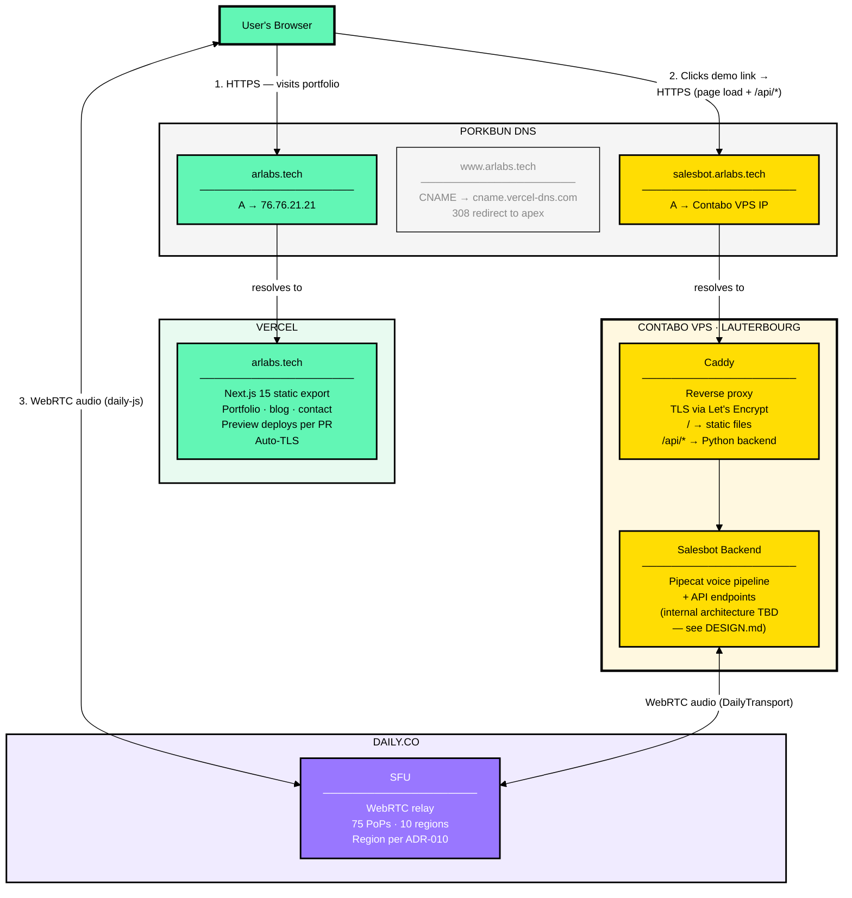

# ADR-008: Hosting topology — portfolio on Vercel, demos on VPS subdomains

**Date:** 2026-04-07
**Status:** Partially Superseded
**Amended:** 2026-04-13 (removed Cloudflare from scope — separate concern; fixed Next.js → Vite per ADR-011)
**Superseded by:** [ADR-019](ADR-019.md) (voice pipeline portion — bot moves to Pipecat Cloud, frontend to Vercel)

## Context

The salesbot involves three categories of code with different runtime characteristics:

1. **Static portfolio content** (`arlabs.tech` — hero, projects, blog, etc.) — pure HTML/CSS/JS, no backend dependency, benefits from a global CDN.
2. **React UI for the salesbot demo** (connect button, waveforms, transcript, pipeline progress) — static HTML/CSS/JS once built (Vite static export per [ADR-011](ADR-011.md)), conceptually paired with the backend.
3. **Python backend** (FastAPI LLM module + Pipecat Voice module) — long-lived processes, WebRTC, stateful pipeline. Cannot run on serverless.

The original implicit plan was "frontend on Vercel, backend on VPS". This was examined and found to have hidden costs:

- **CORS complexity:** the React UI on `arlabs.tech` calling an API on a Contabo IP requires explicit CORS middleware and gets fragile as domains change.
- **Two deploy targets per demo:** every demo in the planned portfolio (salesbot now, more later) would need both a Vercel project and a VPS deployment, doubling operational surface.
- **No latency benefit for audio:** the audio path is browser ↔ Daily.co ↔ Voice module via WebRTC. It never touches Vercel or the VPS's public IP for media. The only HTTP request the frontend makes to the backend is the one-time room-creation handshake (`POST /api/rooms`). Initial page load TTFB from a European VPS to a European user is acceptable without CDN.
- **Slight availability penalty:** P(both up) = 99.95% × 99.9% = 99.85% (Option A) vs P(VPS up) = 99.9% (Option B). Adding Vercel adds a failure mode without adding redundancy for the salesbot itself.
- **Worse failure mode:** if the VPS goes down in Option A, the frontend still loads but the Connect button fails — confusing UX for a demo. In Option B, the demo subdomain returns 503 — clean failure.

The portfolio content, by contrast, has no backend dependency and is genuinely better off on Vercel — Vercel's preview-deploys-per-PR workflow is real value for content iteration, and the portfolio site doesn't need to be coupled to any demo's lifecycle.

## Decision

We will adopt a **subdomain split architecture**:

```
arlabs.tech              → Vercel  (portfolio site + blog, static, no backend)
salesbot.arlabs.tech     → Contabo VPS  (full salesbot: React frontend + Python backend, same origin)
demoN.arlabs.tech        → Contabo VPS  (future demos, same pattern)
```

Concretely for the salesbot subdomain:

- **Caddy** runs on the Contabo VPS as the reverse proxy
- Caddy serves the Vite static build at `/` (see [ADR-011](ADR-011.md) for framework choice)
- Caddy reverse-proxies `/api/*` to the FastAPI LLM module on a localhost port
- Caddy auto-provisions and renews TLS certificates from Let's Encrypt
- The Python Voice module (Pipecat) runs as a separate process on the same VPS, communicating with the LLM module over localhost HTTP
- The frontend and backend share the same origin, so **no CORS configuration is required**

The arlabs.tech portfolio site stays exactly as it is now — Vercel-hosted Next.js, deployed via the existing process, untouched by salesbot work.

**CDN (Cloudflare or otherwise) is not part of this decision.** Whether to put a CDN in front of the VPS is a separate deployment configuration choice evaluated at milestone 0.3. The subdomain split architecture works with or without a CDN proxy. See Notes below for context on when a CDN might be justified.

### Deployment Diagram



_C4 Deployment Diagram: Hosting topology and user journey. The user (1) visits arlabs.tech on Vercel, (2) clicks a demo link which navigates to salesbot.arlabs.tech on the VPS, then (3) WebRTC audio flows through Daily.co — never touching the VPS public interface. The two subdomains resolve to completely independent infrastructure via Porkbun DNS._

## Consequences

### Positive

- **Single deploy target per demo.** Caddy + systemd + git pull + restart is the entire deploy story for the salesbot subdomain. The same workflow extends to every future demo on `demoN.arlabs.tech`.
- **No CORS complexity.** Frontend and backend share the same origin.
- **Cleaner failure mode.** When the VPS or backend dies, the demo subdomain returns 503 — honest failure instead of "frontend loads but Connect breaks."
- **Slightly better availability for the salesbot end-to-end** (~99.9% vs ~99.85%).
- **Portfolio site stays decoupled.** A salesbot outage cannot take down `arlabs.tech`, and a portfolio refresh deploy cannot break the salesbot.
- **Cost-equivalent or better.** Contabo cost is unchanged; no Vercel project for the salesbot means no risk of accidentally consuming Vercel quotas as demos grow.
- **The pattern scales to a portfolio of demos** without multiplying Vercel projects. One VPS, one Caddy config — N subdomains.

### Negative

- **No Vercel-style preview deploys per PR for the salesbot** — Caddy doesn't ship that workflow out of the box. If preview-per-branch becomes important later, can be solved with a GitHub Action that deploys to a `preview-NNN.salesbot.arlabs.tech` subdomain on the same VPS, but it's manual setup.
- **VPS becomes a single point of failure for all demos.** If the VPS dies, every demo subdomain dies simultaneously. Mitigation: the portfolio (which is the main credibility asset) lives on Vercel and is unaffected.
- **Practical limit of ~5-10 concurrent voice sessions per VPS** (per Pipecat's official deployment docs for subprocess-based bots). Acceptable for V0 through V2; will require migration to per-session VMs (Fly.io, Pipecat Cloud) at higher load. The migration path is preserved — the React frontend on the VPS is just static files that can move anywhere.
- **Higher TTFB for geographically-distant users** compared to a CDN-fronted setup. For the initial page load (not audio — audio goes through Daily.co), a user in Singapore hitting a Lauterbourg VPS will see ~300ms TTFB vs ~40ms with a CDN edge. Acceptable for a demo; revisit if global reach becomes important.

### Neutral

- The audio path is unchanged regardless of frontend hosting — browser ↔ Daily.co ↔ Voice module on VPS — so this decision has **zero effect on conversational latency**. Daily.co's region selection (see [ADR-010](ADR-010.md)) handles voice latency for distant users independently.
- The `arlabs.tech/salesbot` URL described in earlier planning becomes `salesbot.arlabs.tech` — slightly different but cleaner architecturally and easier to migrate to a fully separate site if the salesbot ever graduates.
- This decision is reversible. If preview-deploys or some other Vercel-specific benefit becomes important later, moving the React frontend back to Vercel is mechanical (it's a static export).

## Notes

- Daily.co handles all WebRTC media routing and has its own global PoP infrastructure, so the frontend hosting choice is genuinely independent of voice latency. See [ADR-010](ADR-010.md) for the region-selection decision that addresses voice latency for geographically-distant users.
- Real-time data flow (transcript, visualizer, status events) uses Pipecat's RTVI / Daily data channels. See [ADR-009](ADR-009.md).
- **CDN consideration (deferred):** If global page-load latency becomes important (e.g., demos targeted at non-European audiences), putting a CDN (Cloudflare, Bunny, or similar) in front of the VPS is an option. This only affects initial page load TTFB — not voice interaction latency. Evaluate at milestone 0.3 based on actual audience geography.
