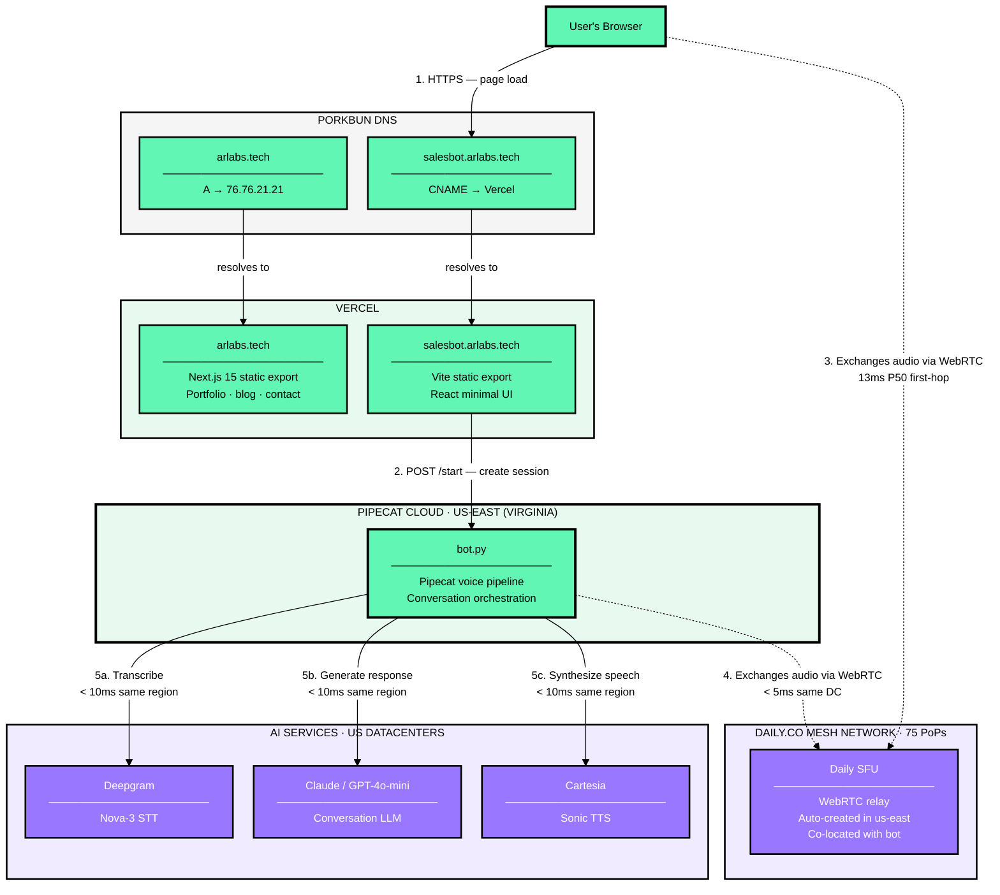

# ADR-019: Migrate voice pipeline from VPS to Pipecat Cloud

**Date:** 2026-06-01
**Status:** Accepted
**Supersedes:** ADR-008 (hosting topology, voice pipeline portion), ADR-010 (Daily region selection)

## Context

The salesbot voice pipeline runs on a Contabo VPS in Lauterbourg, France. All three AI services it calls — Deepgram (STT), Claude/GPT-4o-mini (LLM), and Cartesia (TTS) — are hosted in US datacenters. This creates a compounding latency problem:

```mermaid
%%{init: {
  'theme': 'base',
  'themeVariables': {
    'primaryColor': '#ffffff',
    'primaryBorderColor': '#000000',
    'primaryTextColor': '#000000',
    'lineColor': '#000000',
    'fontSize': '13px',
    'fontFamily': 'Outfit, sans-serif',
    'edgeLabelBackground': '#ffffff'
  },
  'flowchart': {
    'nodeSpacing': 25,
    'rankSpacing': 60,
    'curve': 'basis',
    'padding': 14
  }
}}%%

flowchart LR
    subgraph USER_REGION ["USER · THAILAND"]
        BROWSER["User's Browser"]
    end

    subgraph DAILY_REGION ["DAILY SFU · SINGAPORE"]
        SFU["Daily SFU
        ─────────────────────
        Pinned to ap-southeast"]
    end

    subgraph VPS_REGION ["CONTABO VPS · FRANCE"]
        BOT["bot.py
        ─────────────────────
        Pipecat voice pipeline"]
    end

    subgraph API_REGION ["AI SERVICES · US"]
        DEEPGRAM["Deepgram STT"]
        LLM["Claude / GPT-4o-mini"]
        CARTESIA["Cartesia TTS"]
    end

    BROWSER -.->|"Exchanges audio via WebRTC\n~30ms"| SFU
    SFU -.->|"Relays audio via WebRTC\n~180ms"| BOT
    BOT -->|"~120ms RTT"| DEEPGRAM
    BOT -->|"~120ms RTT"| LLM
    BOT -->|"~120ms RTT"| CARTESIA

    style USER_REGION fill:#e8faf0,stroke:#000000,stroke-width:2px,color:#000000
    style DAILY_REGION fill:#f0ebff,stroke:#000000,stroke-width:2px,color:#000000
    style VPS_REGION fill:#fff8e0,stroke:#000000,stroke-width:3px,color:#000000
    style API_REGION fill:#f0ebff,stroke:#000000,stroke-width:2px,color:#000000
    style BROWSER fill:#62f6b5,stroke:#000000,stroke-width:3px,color:#000000
    style SFU fill:#9977ff,stroke:#000000,stroke-width:2px,color:#ffffff
    style BOT fill:#ffdd03,stroke:#000000,stroke-width:3px,color:#000000
    style DEEPGRAM fill:#9977ff,stroke:#000000,stroke-width:2px,color:#ffffff
    style LLM fill:#9977ff,stroke:#000000,stroke-width:2px,color:#ffffff
    style CARTESIA fill:#9977ff,stroke:#000000,stroke-width:2px,color:#ffffff
```

_C4 Deployment Diagram: Current (problematic) topology. The bot in France is far from both the Daily SFU (Singapore) and all AI services (US). Every voice turn pays ~180ms for the bot-to-SFU hop plus ~360ms across three sequential transatlantic API calls._

Three sequential API calls per voice turn, each crossing the Atlantic. The bot-to-API transit alone adds ~360ms before any processing starts. Combined with the bot-to-SFU hop (France → Singapore), total overhead exceeds 450ms — nearly half of a 1000ms voice-to-voice latency budget consumed by geography alone.

This was validated empirically: the local dev server (bot co-located with the user, APIs still in US) had no perceptible lag. The production VPS had obvious, conversation-breaking lag on the same React minimal frontend.

### Why region selection (ADR-010) is no longer sufficient

ADR-010 optimised the user-to-SFU leg by placing the Daily room near the user. This helped, but the analysis in ADR-010's Consequences section noted: "The bot-to-LLM-API path is unchanged by region selection... Total turn latency improvement is bounded." That bound has now been reached. The remaining latency is in the bot-to-API hops, which region selection cannot fix.

### Evidence base

Daily.co's engineering team published "The World's Fastest Voice Bot" (Jan 2025), demonstrating 500ms median voice-to-voice latency by co-locating bot, LLM, and TTS in the same datacenter. Their key finding: "Colocating voice bot code, the LLM, and TTS in the same infrastructure saves us 50–200ms of latency from network requests to external AI services."

This is triangulated by Modal's benchmark (same-region pinning vs distributed: substantial improvement), Pipecat's own STT latency tuning docs (listing "network distance to the STT provider" as an explicit variable), and Cresta's engineering post (200–300ms RTT penalty for cross-region inference calls).

Full research: D2 researchbot investigation, 22 sources, 14 at CRAAP ≥4.0. Conducted 2026-06-01.

### Why Pipecat Cloud specifically

Three deployment options were considered:

1. **US-East VPS** ($5/mo) — co-locates bot with APIs. Manual systemd/Caddy management continues. Gets ~80% of the latency benefit.
2. **Pipecat Cloud** — managed Pipecat hosting with automatic bot-SFU co-location. 4 regions (us-west, us-east, eu-central, ap-south). `pipecat deploy` replaces SSH + SCP + systemctl. Same bot.py runs unchanged.
3. **Cerebrium** — serverless GPU platform. Co-locates everything including self-hosted LLM (<10ms inter-container). Requires replacing Claude with an open model (Llama). Latency-optimal but sacrifices LLM quality.

Option 2 (Pipecat Cloud) is the right balance: it solves the co-location problem, eliminates VPS operational burden, preserves the Claude/GPT-4o-mini LLM choice, and the bot code doesn't change.

## Decision

Migrate the voice pipeline from the Contabo VPS to **Pipecat Cloud `us-east`** (Virginia).

### Target deployment topology

_C4 Deployment Diagram: Target salesbot topology. The bot runs on Pipecat Cloud us-east, co-located with the Daily SFU (auto-created in the same region) and all three AI services (Deepgram, Claude, Cartesia — all US datacenters). The frontend moves to Vercel for global CDN delivery. Steps 5a–5c are sequential but each < 10ms same-region, replacing the ~120ms transatlantic hops of the VPS topology._

| Colour | Meaning |
|--------|---------|
| Mint (`#62f6b5`) | Your infrastructure — frontend, bot, DNS routing |
| Purple (`#9977ff`) | External services — Daily.co, Deepgram, Claude, Cartesia |
| Gray (`#f5f5f5`) | DNS (neutral grouping) |

Specifically:

1. **Bot deployment:** `bot.py` deploys to Pipecat Cloud `us-east` via `pipecat deploy`. No VPS process management.
2. **Daily room creation:** Pipecat Cloud auto-creates Daily rooms co-located with the bot. Remove the `geo` pin from the frontend — it's no longer the frontend's concern.
3. **Frontend hosting:** Move from VPS/Caddy to Vercel. The frontend is already a Vite static build. Vercel gives global CDN, preview deploys, and the `salesbot.arlabs.tech` subdomain via DNS update.
4. **Frontend `/start` endpoint:** Update to point at the Pipecat Cloud bot URL instead of the VPS proxy.
5. **VPS role:** The Contabo VPS stops serving the salesbot. It remains available for other infrastructure (Hermes, etc.) but exits the voice pipeline entirely.

## Consequences

### Positive

- **Latency fix at the architecture level.** Bot in us-east, APIs in US — inter-service hops drop from ~120ms to <10ms each. ~300ms saved per voice turn.
- **No more geo pin management.** Pipecat Cloud handles bot-SFU co-location automatically. ADR-010's region parameter complexity disappears.
- **Operational simplification.** No systemd service, no Caddy config, no SSH deploy, no Python runtime management on the VPS.
- **Frontend gets CDN.** Vercel serves the static build globally. Page load TTFB drops from ~300ms (France VPS) to ~40ms (nearest edge).
- **Preview deploys per PR.** Vercel's workflow for the frontend, which ADR-008 noted as a negative of VPS hosting.
- **Same bot code.** `bot.py` runs unchanged on Pipecat Cloud. No framework migration.

### Negative

- **New vendor dependency.** Pipecat Cloud is GA but young. If the service has outages or changes pricing, we're dependent. Mitigation: the bot is standard Pipecat — can redeploy to any Python host (Fly.io, US VPS, Cloud Run) with the same code.
- **Cost increase.** Pipecat Cloud pricing replaces the ~$0 marginal cost of running the bot on the existing VPS. Need to evaluate pricing before executing.
- **CORS returns.** Frontend on Vercel (`salesbot.arlabs.tech`) calling Pipecat Cloud's bot endpoint is cross-origin. Need CORS headers on the `/start` endpoint, or proxy through Vercel rewrites.
- **Two deploy targets again.** Frontend on Vercel, bot on Pipecat Cloud. ADR-008 chose VPS specifically to avoid this. Mitigated by the fact that both have simple CLI deploys (`vercel` and `pipecat deploy`) vs SSH + SCP.

### Neutral

- ADR-008's hosting topology is superseded for the voice pipeline but its analysis remains valid for understanding the tradeoffs. The "subdomain split" pattern persists — just with different infrastructure behind each subdomain.
- ADR-010's region selection research is superseded by automatic co-location but the latency analysis informed this decision directly.
- The Contabo VPS remains provisioned. It can host other services (Hermes night-shift agent, future infrastructure). No urgency to decommission.

## Migration checklist

- [ ] Evaluate Pipecat Cloud pricing — confirm viable at demo/early-revenue volume
- [ ] Create Pipecat Cloud account, deploy bot.py to us-east
- [ ] Test voice latency from Thailand against Pipecat Cloud bot
- [ ] Deploy frontend to Vercel (new project or subdirectory of arlabs.tech)
- [ ] Update DNS: `salesbot.arlabs.tech` → Vercel
- [ ] Update frontend `/start` endpoint to Pipecat Cloud URL
- [x] Remove `geo: "ap-southeast"` from AppMinimal.tsx (done ahead of the migration by vox-9ji.2.22.4; no request names a region now)
- [ ] Verify production voice conversation end-to-end
- [ ] Stop salesbot-voice systemd service on VPS
- [ ] Update DESIGN.md deployment diagram

## References

- [The World's Fastest Voice Bot — Daily.co](https://www.daily.co/blog/the-worlds-fastest-voice-bot/)
- [Pipecat Cloud Regions — docs.pipecat.ai](https://docs.pipecat.ai/deployment/pipecat-cloud/guides/regions)
- [STT Latency Tuning — docs.pipecat.ai](https://docs.pipecat.ai/pipecat/fundamentals/stt-latency-tuning)
- [Benchmarking STT for Voice Agents — Daily.co](https://www.daily.co/blog/benchmarking-stt-for-voice-agents/)
- [One-Second Voice-to-Voice Latency — Modal](https://modal.com/blog/low-latency-voice-bot)
- [Daily Bots announcement — Daily.co](https://www.daily.co/blog/daily-bots-build-real-time-voice-vision-and-video-ai-agents/)
