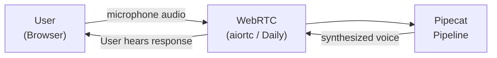
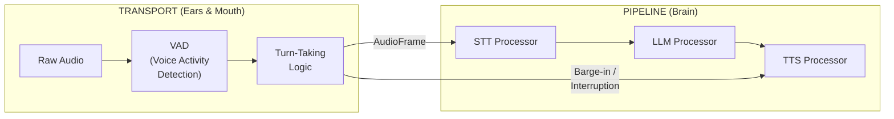
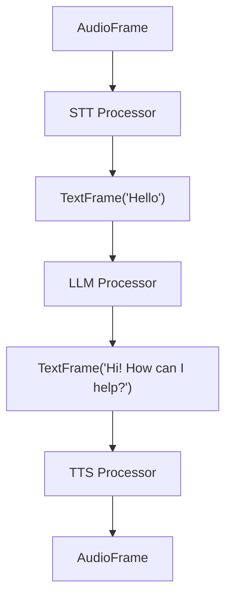
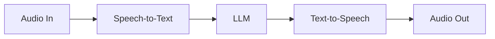
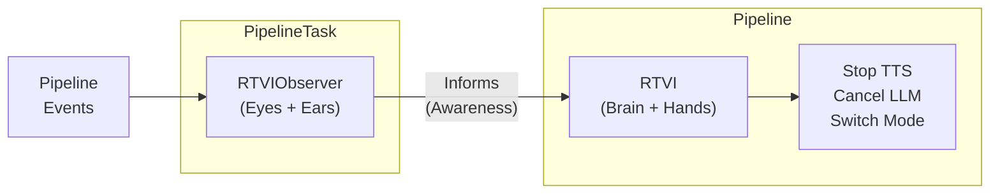
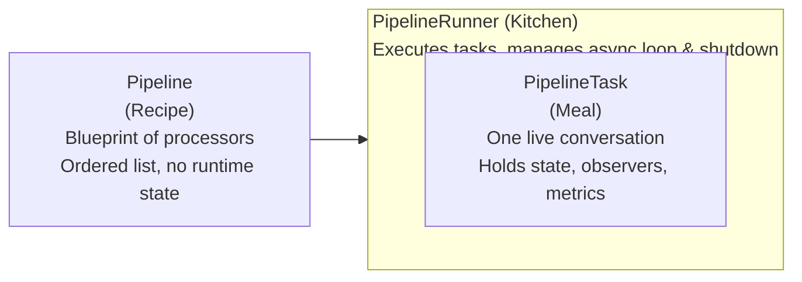
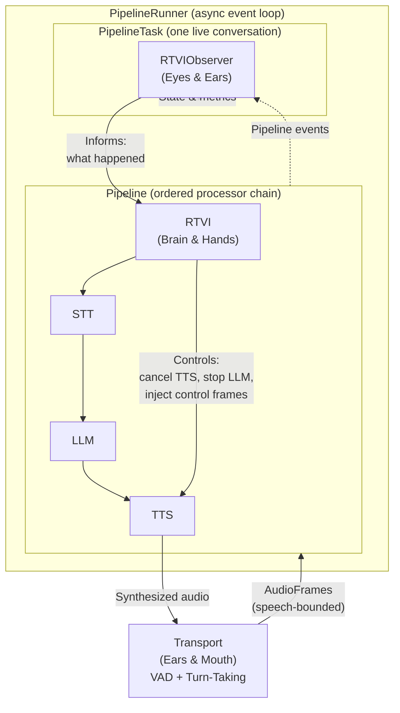
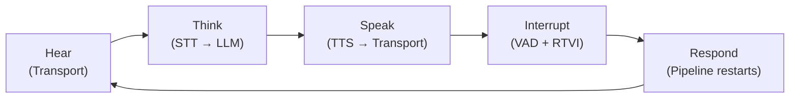

# Pipecat Framework Architecture

**Purpose:** Reference document — how Pipecat works internally. Informs our design decisions (DESIGN.md) and implementation. Not a design document itself.
**Source:** [Pipecat Explained — Building Real-Time Voice AI](https://www.youtube.com/watch?v=66w0iOC4hoc) + Pipecat GitHub documentation
**Visual reference:** `docs/slides/` (extracted from the video above)
**Last Updated:** 2026-04-15

---

## 1. The Two-Layer Model

Pipecat separates voice AI into two distinct layers with different responsibilities.

**High-Level Architecture** (slide at 12:24):


*See `docs/slides/slide_12m24s.jpg`.*

Two responsibilities:
- Transport → move audio
- Pipeline → decide what to do with audio

**Transport vs Pipeline detail — Why VAD & Turn-Taking Run Inside the Transport** (slide 006):


*See `docs/slides/slide_006.jpg`.*

**Transport** moves audio and handles timing. It does zero AI — no transcription, no thinking, no synthesis. In our stack, Daily.co provides this layer (the video uses `aio-rtc`, a lower-level Python WebRTC library).

**Pipeline** decides what to do with the audio. It receives speech-bounded audio frames from the transport and processes them through a chain of processors.

### Why the separation matters

- VAD and Turn-Taking work on **raw audio** and must react in **milliseconds**
- They run *before* any pipeline processing begins — they're gatekeepers
- The transport can **interrupt** the pipeline mid-run (barge-in) if the human starts speaking
- This prevents wasted STT/LLM/TTS work when the user interrupts
- The pipeline only deals with **meaning-level** data, never raw audio timing

**Mental model:** Transport = ears and mouth. Pipeline = brain and nervous system.

---

## 2. Frames — The Atomic Unit

Everything flowing through Pipecat is a **frame**. Frames are the fundamental data unit — typed chunks that processors receive, transform, and emit.

| Frame Type | Example | What It Carries |
|-----------|---------|----------------|
| **AudioFrame** | Raw audio samples from mic, synthesized speech | Sound data |
| **TextFrame** | `TextFrame("Hello")`, `TextFrame("Hi, how can I help?")` | Text data (transcriptions, LLM responses) |
| **ControlFrame** | `LLMRunFrame()`, Stop, Interrupt | Pipeline control signals |

### Why frames matter

Frames are what make **interruption** possible. When RTVI needs to stop the AI mid-sentence, it injects a control frame that cancels downstream processing. Without typed frames, you'd need complex state management to coordinate cancellation across processors.

Frames also enable **streaming**. Each processor emits frames incrementally — the TTS processor can start synthesizing audio before the LLM has finished generating the full response, because it receives text frames as they arrive.

---

## 3. Processors

A processor is a single step in the pipeline — a function that receives incoming frames and produces outgoing frames, asynchronously and incrementally.

**Conceptual model** — Incoming Frames → PROCESSOR (Function) → Outgoing Frames. It only focuses on one responsibility.

**Example frame flow through a typical voice pipeline** (slide 008):


*See `docs/slides/slide_008.jpg`.*

Processors don't talk directly to each other. They communicate using frames.

**The Pipeline Concept** — a chain of processors, typical voice pipeline (slide at 14:48):


*See `docs/slides/slide_14m48s.jpg`.*

Each step receives frames and emits frames. This makes the system modular, replaceable, and streamable.

### Key properties

- **One responsibility** per processor — STT only transcribes, LLM only reasons, TTS only synthesizes
- **Modular and replaceable** — swap Deepgram for Whisper by replacing one processor
- **Stream-friendly** — processors emit frames as they become available, not in batch
- **No direct communication** — processors don't talk to each other directly; they communicate through frames flowing through the pipeline

### What a processor does NOT do

- Handle networking (that's the transport)
- Manage WebRTC (that's the transport)
- Control the event loop (that's the PipelineRunner)
- Decide when to run (that's RTVI)

---

## 4. RTVI — Controlling the AI

RTVI (Real-Time Voice Inference) is the most important and most confusing part of Pipecat. It answers: **when should the AI act, and when should it stop?**

### The key distinction

| Component | Listens to | Controls |
|-----------|-----------|----------|
| **VAD** | The human (is someone speaking?) | Nothing — just detects |
| **Turn Analyzer** | The human (are they done?) | Nothing — just signals |
| **RTVI** | The AI (should it run? should it stop?) | LLM, TTS, pipeline flow |

**VAD and Turn Analyzer listen to the human. RTVI controls the AI.**

### The barge-in scenario

This is the critical scenario that explains why RTVI exists:

```
AI is speaking: "Sure, I can help you with—"
User interrupts: "Actually, wait..."

1. VAD:            Detects speech → "human is speaking"
2. Turn Analyzer:  Not involved yet (hasn't determined turn end)
3. RTVI:           Cancels TTS and LLM immediately

Without RTVI: AI keeps talking. Conversation feels broken.
```

*See `docs/slides/slide_18m02s_rtvi_confusing.jpg`.*

### RTVI sits at the TOP of the pipeline

RTVI must come before STT, LLM, and TTS in the pipeline order so it can observe input and control downstream behavior (slide 018):

```python
Pipeline([
    transport.input(),   # audio from user
    rtvi,                # coordination
    stt,                 # audio → text
    llm,                 # thinking
    tts,                 # text → audio
    transport.output(),  # audio to user
])
```

*See `docs/slides/slide_018.jpg` (Pipeline Order — Why It Matters).*

RTVI must come early so it can:
- **Observe input** — see what's coming from the transport
- **Control downstream behavior** — decide whether STT/LLM/TTS should run
- **Inject control frames** — send cancellation signals downstream

---

## 5. RTVI vs RTVIObserver

RTVI is split into two parts that live in different places (slide at 20:20):


*See `docs/slides/slide_20m20s_rtvi_vs_observer.jpg`.*

| | RTVI (Processor) | RTVIObserver |
|---|---|---|
| **Location** | Inside the pipeline | Inside the PipelineTask |
| **Role** | Brain + hands | Eyes + ears |
| **What it does** | Cancels LLM/TTS, injects control frames, actively changes behavior | Listens to pipeline events, informs RTVI what happened |
| **Analogy** | The brain decides and acts | The eyes see and report |

**RTVI does not decide on its own.** RTVIObserver sees events (e.g., "human started speaking") and tells RTVI, which then acts (e.g., cancel TTS).

---

## 6. Observers — Pipeline Visibility

Observers watch what happens during pipeline execution. They are event-driven — they don't see every audio chunk or every LLM token.

### What observers see

- When something **starts** (STT started, LLM started, TTS started)
- When something **ends** (turn ended, LLM finished, TTS finished)
- **Meaningful milestones** only

### What observers do NOT see

- Every audio chunk (too frequent)
- Every LLM token (too frequent)
- Frame-by-frame data flow

**Mental model:** Observers see chapters in a book, not every word. High-frequency data (audio chunks, LLM tokens) is filtered down to meaningful milestones before observers are notified. This protects real-time performance.

*See `docs/slides/slide_22m20s_observers_notified.jpg`.*

---

## 7. Pipeline, PipelineTask, PipelineRunner

Three distinct runtime concepts (slide 015):


*See `docs/slides/slide_015.jpg`.*

| Concept | Analogy | What It Is | What It Holds |
|---------|---------|------------|---------------|
| **Pipeline** | Recipe | Blueprint — which processors, in what order | No state — just the ordered list |
| **PipelineTask** | Meal being cooked | A running instance of the pipeline | State, observers (including RTVIObserver), metrics |
| **PipelineRunner** | Kitchen | Executor | Async event loop, shutdown handling |

```python
pipeline = Pipeline([...])          # The recipe
task = PipelineTask(pipeline)       # Start cooking
runner = PipelineRunner()           # The kitchen
await runner.run(task)              # Go
```

*See `docs/slides/slide_17m52s_minimal_code.jpg`.*

---

## 8. Metrics

Pipecat tracks performance metrics per PipelineTask (per conversation):

- **Latency** (ms) — time from user speech end to AI response start
- **Duration** (s) — total conversation length
- **Token usage** (k) — LLM tokens consumed

Metrics are enabled per PipelineTask and used for cost and performance tracking. They function as dashboard gauges — not detailed logs, but high-level indicators.

*See `docs/slides/slide_23m04s_metrics.jpg`.*

---

## 9. First Turn — What Happens When a User Connects

When a user connects, the pipeline is idle — nobody has spoken yet. The bot must speak first to start the conversation naturally ("Hello, how can I help you?"). This requires a manual trigger.

**Two trigger patterns exist depending on transport:**

| Pattern | Event | When to use |
|---------|-------|-------------|
| Immediate | `@transport.event_handler("on_client_connected")` | SmallWebRTC (P2P) — client is already there |
| Handshake | `@task.rtvi.event_handler("on_client_ready")` | Daily (room-based) — must wait for RTVI handshake |

The quickstart bot.py uses `on_client_ready` (the RTVI/Daily pattern), which also works on SmallWebRTC because the RTVI handshake happens on both transports. This means no change is needed when swapping from SmallWebRTC to Daily.

```python
# Quickstart pattern (bot.py line 121-125)
@task.rtvi.event_handler("on_client_ready")
async def on_client_ready(rtvi):
    context.add_message({"role": "user", "content": "Please introduce yourself."})
    await task.queue_frames([LLMRunFrame()])
```

**What this does step by step:**

1. WebRTC connection established (audio channel open)
2. Client SDK sends RTVI "client ready" message over data channel
3. `on_client_ready` fires on the server
4. `context.add_message(...)` adds a fake "user" message to the conversation history — simulating a user prompt to trigger the LLM
5. `LLMRunFrame()` is a **control frame** — it tells the pipeline "run the LLM now with the current context" without waiting for user audio
6. LLM generates greeting → TTS synthesises → audio plays in browser
7. The bot has "spoken first"

`LLMRunFrame` is how you programmatically trigger the LLM. Normally the pipeline runs reactively (user speaks → STT → LLM → TTS). The control frame bypasses the need for user audio input.

Similarly, `on_client_disconnected` cancels the pipeline task to clean up resources.

*See `docs/slides/slide_23m48s_user_connects.jpg`.*

---

## 10. The Complete Mental Model

### How the Sub-Components Work Together


*See `docs/slides/slide_24m59s_mental_picture.jpg`.*

**What each component does for the others:**

| Component | Role | Lives In | Talks To |
|-----------|------|----------|----------|
| **Transport** | Moves audio, runs VAD + turn-taking on raw audio | Standalone | Pipeline (sends AudioFrames) |
| **Pipeline** | Ordered chain: RTVI → STT → LLM → TTS | PipelineRunner | Transport (receives/sends audio) |
| **RTVI** | Controls AI behavior — triggers LLM, cancels TTS on barge-in | Pipeline (first processor) | Downstream processors |
| **RTVIObserver** | Watches pipeline events, informs RTVI what happened | PipelineTask | RTVI (awareness feedback) |
| **PipelineTask** | Holds state, observers, metrics for one conversation | PipelineRunner | Observer, RTVI |
| **PipelineRunner** | Executes tasks, manages async loop and shutdown | Top level | PipelineTask |

### The Human Conversation Loop

Pipecat mirrors how humans converse. Each sub-component maps to a step in the natural conversation cycle:



| Conversation Step | Pipecat Component | What Happens |
|-------------------|-------------------|--------------|
| **Hear** | Transport (Daily.co) + VAD | Audio arrives, VAD detects speech, turn-taking gates it |
| **Think** | STT → LLM | Speech transcribed, LLM reasons about response |
| **Speak** | TTS → Transport | Response synthesized and sent back as audio |
| **Interrupt** | VAD detects + RTVI acts | User speaks mid-response, RTVI cancels TTS/LLM |
| **Respond** | Pipeline restarts | New turn begins from the interruption |

**Result:** Natural, low-latency, interruptible, conversational voice AI.

*See `docs/slides/slide_24m59s_mental_picture.jpg` and `docs/slides/slide_25m44s_final_model.jpg`.*

---

## 11. Context Aggregators — Conversation Memory

The pipeline needs to maintain conversation history so the LLM sees prior turns. Two aggregator objects handle this, created as a pair sharing the same `LLMContext`:

```python
context = LLMContext()  # shared conversation history: [{"role": "...", "content": "..."}]
user_aggregator, assistant_aggregator = LLMContextAggregatorPair(
    context,
    user_params=LLMUserAggregatorParams(vad_analyzer=SileroVADAnalyzer()),
)
```

| Aggregator | Position in pipeline | What it does |
|-----------|---------------------|-------------|
| `user_aggregator` | Before the LLM | Accumulates STT output. When VAD signals the user has stopped speaking, flushes accumulated text into context as `{"role": "user", "content": "..."}` |
| `assistant_aggregator` | After `transport.output()` | Records the bot's response into context as `{"role": "assistant", "content": "..."}` after it has been spoken |

**Why they're in different positions:** The user aggregator goes before the LLM so the current utterance is in context when the LLM runs. The assistant aggregator goes after output so it only records what was actually spoken — if the user barge-ins mid-sentence, the truncated response is what gets recorded, not the full generation.

**Why VAD is passed to the user aggregator:** The aggregator needs to know when the user has finished their turn before releasing text to the LLM. SileroVAD detects silence in the audio stream. The aggregator uses that signal as the gate: "STT is producing text, but has the human stopped? VAD says yes → flush to context → let frames flow to LLM."

The assistant aggregator doesn't need VAD — the bot's turn ends when TTS finishes synthesising. No ambiguity.

**Context grows turn by turn:**
```
After greeting:  [user: "Please introduce yourself", assistant: "Hi, I'm..."]
After turn 2:    [..., user: "What do you do?", assistant: "I help with..."]
After turn 3:    [..., user: "Tell me more", assistant: "Sure, specifically..."]
```

The LLM receives the entire history on every turn. This is how the conversation maintains coherence without explicit memory — the context *is* the memory. (V3+ will add persistent memory beyond the session.)

---

## 12. The Development Runner — Convention Over Configuration

The quickstart's entry point hides a non-obvious pattern:

```python
if __name__ == "__main__":
    from pipecat.runner.run import main
    main()
```

`main()` starts a FastAPI/uvicorn server. When a browser connects, the server needs to find and call your bot code. It does this by **reflection** — inspecting the running program at runtime:

```python
# Inside main() (simplified)
main_module = sys.modules["__main__"]     # "what file was executed with `python bot.py`?"
bot_function = getattr(main_module, "bot") # "does it have a function called 'bot'?"
# later, per-connection:
background_tasks.add_task(bot_function, runner_args)
```

This is **convention over configuration** — the framework assumes your entry point is named `bot` rather than requiring explicit registration. The linkage is invisible in the code: you can't grep for "who calls bot()" and find the answer in your codebase. The call happens inside the framework.

**One server, many bots:** `main()` creates one uvicorn process. Each connecting user gets their own `bot()` call as a FastAPI background task — their own transport, pipeline, and runner as async coroutines inside the same process. Not separate processes or threads. Multiple users share CPU time through Python's async event loop; while one pipeline awaits an API response, others can run.

**What `main()` does (complete list):**
1. Parses CLI args (`--transport webrtc|daily`, `--port 7860`, etc.)
2. Creates a FastAPI app with transport-appropriate routes
3. For SmallWebRTC: mounts prebuilt UI at `/client`, registers `POST /api/offer` and `PATCH /api/offer`
4. Starts uvicorn
5. Per-connection: discovers `bot()` by name, calls it with `runner_args` containing the established connection

Everything from step 5 onward is your code in `bot.py`.

### Transport selection via CLI flag

The transport is chosen at server startup, not per connection. The CLI flag determines which FastAPI routes get registered:

```bash
uv run bot.py              # default: -t webrtc (SmallWebRTC mode)
uv run bot.py -t daily     # Daily mode (requires DAILY_API_KEY)
uv run bot.py -t twilio    # telephony mode
```

`main()` reads the flag, then calls the matching route setup:
- `webrtc` → `_setup_webrtc_routes()` — mounts prebuilt UI at `/client`, registers `/api/offer`
- `daily` → `_setup_daily_routes()` — registers `/connect` endpoint that creates Daily rooms via API
- `twilio` → `_setup_telephony_routes()` — registers webhook + WebSocket endpoints

Once the server is running, the transport mode is locked. The same `bot.py` file can run in any mode depending on how it's invoked — the bot's logic is identical, only the server-side connection handling differs. Inside `bot()`, the `match runner_args:` block picks the transport class that matches the mode the server was started in.

### State isolation per connection

Each `bot()` call creates its own local variables — `transport`, `stt`, `tts`, `llm`, `context`, `pipeline`, `task`, `runner`. Standard Python function scope rules apply. User A's `context` cannot leak into user B's `context` because they are different local objects in different coroutine frames. No shared state unless explicitly created as module-level globals.

### Why async, not threads or processes

Voice pipelines are I/O-bound — most time is spent waiting for network responses (Deepgram, OpenAI, Cartesia, WebRTC audio frames). Async coroutines are the right tool:

| Model | Cost per connection | Used for |
|-------|---------------------|----------|
| Process (multiprocessing) | OS process (~10MB+ memory, slow creation) | CPU-bound work, total isolation |
| Thread | OS thread (~8MB stack, context-switch overhead) | I/O-bound with blocking libraries |
| Coroutine (asyncio) | Small Python object (~KB, instant) | I/O-bound with async libraries |

Pipecat uses asyncio because its services (Deepgram WebSocket, OpenAI streaming API, Cartesia streaming HTTP) all provide async clients. Each pipeline spends most of its time at `await` points. While one pipeline waits on Deepgram, another runs its LLM response.

The practical ceiling (~5–10 concurrent sessions per VPS) comes from Silero VAD running synchronous ML inference on the CPU — the one thing that doesn't yield. Scaling beyond that requires per-session VMs or GPU offload, not a different concurrency model.

---

## 13. WebRTC Signaling — The `/api/offer` Handshake

Before any audio flows, browser and server must agree on how to send media. This is **WebRTC signaling**, and `/api/offer` is where it happens in SmallWebRTC mode.

### SDP — Session Description Protocol

SDP is a plain-text format describing a peer's media capabilities and network addresses. An SDP document looks roughly like:

```
v=0
o=- 12345 2 IN IP4 127.0.0.1
s=-
t=0 0
m=audio 54321 UDP/TLS/RTP/SAVPF 111
a=rtpmap:111 opus/48000/2
a=candidate:1 1 udp 2130706431 192.168.1.5 54321 typ host
```

It says: "I want one audio track, I support opus codec, my network candidates are these addresses."

### The handshake

1. **Browser creates an offer** — an SDP document listing its codecs, media tracks, and network candidates
2. **Browser POSTs the offer** to `/api/offer` with the SDP as the request body
3. **Server (aiortc) creates an answer** — an SDP document agreeing to codecs and providing its own network candidates
4. **Server returns the answer** as the HTTP response body
5. **ICE candidates exchanged via PATCH** — additional network paths discovered after initial handshake (STUN-reflected addresses, TURN relays)
6. **Peer connection established** — both sides now know how to reach each other
7. **Audio flows directly over WebRTC** — no more HTTP involved

The HTTP layer is used only for the initial negotiation. Once the WebRTC peer connection is up, audio streams directly between browser and server (in SmallWebRTC mode) or via Daily's SFU (in Daily mode).

### What the framework does during the handshake

The `/api/offer` handler in `pipecat.runner.run`:

1. Receives the SDP offer
2. Passes it to `SmallWebRTCRequestHandler`, which uses `aiortc` (Python WebRTC library) to negotiate
3. Once negotiation completes, invokes a callback with the live `SmallWebRTCConnection` object
4. In the callback: discovers `bot()` via `sys.modules["__main__"]`, wraps the connection in `SmallWebRTCRunnerArguments`, queues `bot(runner_args)` as a FastAPI background task
5. Returns the SDP answer to the browser

The browser gets the SDP answer immediately (HTTP response), while the bot pipeline starts running in the background on the same event loop. Audio begins flowing as soon as the WebRTC peer connection is established — which is before `bot()` even finishes assembling its pipeline. The pipeline's `transport.input()` processor simply starts receiving audio frames once the connection is live.

### Daily mode differs

In Daily mode, the signaling flow is different. The browser doesn't POST an SDP offer to our server. Instead:

1. Browser calls `/connect` on our server to get a room URL + token
2. Browser joins the Daily room using the `daily-js` SDK (Daily handles its own signaling with their infrastructure)
3. Our bot joins the same Daily room via `DailyTransport`
4. Audio flows peer-to-peer through Daily's SFU

The SDP negotiation happens between browser↔Daily and bot↔Daily independently. Our server doesn't handle WebRTC signaling at all — Daily does. That's the fundamental simplification Daily provides, at the cost of depending on their infrastructure.

---

## Implications for Our Design

Key findings that affect our design and implementation:

1. **Pipeline order is critical** — RTVI must come before STT/LLM/TTS; documented in Known Gotchas (PIPECAT-PLAN.md)
2. **VAD conceptually lives in the transport layer** but is passed as a parameter to the user aggregator in practice — it gates when accumulated transcript text is released to the LLM
3. **RTVIObserver lives in PipelineTask, not the pipeline** — it watches pipeline events and informs the RTVI processor. Created automatically when PipelineTask is instantiated.
4. **First-turn uses `on_client_ready` (RTVI handshake)** not `on_client_connected` — works on both SmallWebRTC and Daily, no change needed at transport swap (see section 9 above)
5. **Context aggregators maintain conversation history** — the user and assistant aggregators share an LLMContext object that grows turn by turn (see section 11 above)
6. **The development runner uses convention over configuration** — discovers `bot()` by name via `sys.modules["__main__"]`, calls it per-connection as a background task (see section 12 above)
7. **Open question for 0.2.3:** The inline LLM pattern (OpenAILLMService in pipeline) is async and streaming — the pipeline stays responsive during inference. Separate LLM module may not be needed for V0. See BUILD.md milestone 0.2.3.

---

## Source Reference

- **Video:** [Pipecat Explained — Building Real-Time Voice AI](https://www.youtube.com/watch?v=66w0iOC4hoc)
- **Transcript:** `library/transcripts/1-pipecat-explained-building-real-time-v-66w0iOC4hoc.txt`
- **Slides:** `docs/slides/` (22 frames extracted from the video)
- **Pipecat GitHub:** [pipecat-ai/pipecat](https://github.com/pipecat-ai/pipecat)
- **Quickstart example:** `pipecat/examples/quickstart/bot.py` (shown in slides 001 and 029)
